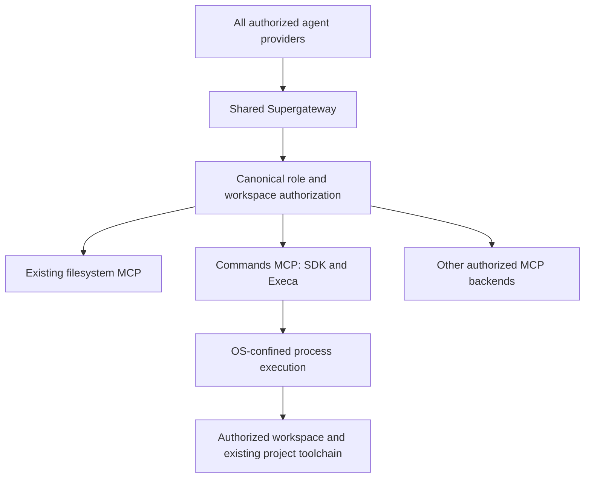

# Allowlisted Commands MCP — Design and Migration Plan

> **Status:** Proposed; no command backend or live acceptance is implied by this document.
>
> **Authority:** [AutoDev unified target state](autodev-console-target-state.md#allowlisted-command-execution) owns durable architecture and authorization requirements. This focused subsystem plan explains the rationale, proposed implementation, migration order and acceptance gates. Record observed deployment evidence in [the migration tracker](autodev-console-migration.md), and operational instructions in [local setup](local-setup.md) when implemented.

## 1. Problem and decision

ChatGPT and other agents using the shared MCP gateway can inspect and edit workspace files but need a provider-independent way to execute approved deterministic development operations. For example:

```sh
pnpm install --no-frozen-lockfile
pnpm run typecheck
pnpm test
pnpm run lint:fix
git status
git diff
git add .
git commit -m "..."
```

Requiring XACPX to allocate another model for every such operation introduces latency, cost, provider availability dependencies and unnecessary inference. It can prevent completion of straightforward work such as regenerating a lockfile or running regression checks. XACPX remains the exclusive agent-delegation interface, not a command runner.

**Decision:** Retain the official filesystem MCP and add a narrow, generic `commands` MCP using existing dependencies. Expose fixed, operator-authorized executable/argument definitions as distinct MCP tools through the mandatory shared Supergateway. Do not adopt DesktopCommanderMCP or an unrestricted shell MCP for this use case.

### Alternatives considered

| Approach | Benefits | Costs and decision |
| --- | --- | --- |
| DesktopCommanderMCP replacing filesystem | Maintained TypeScript project; filesystem, search, interactive terminal and background process management in one backend | Different file schemas/edit semantics; command blocklist rather than proven exact argv grants; extra configuration, process ownership and confinement work; larger surface. Not selected. |
| Separate third-party allowlisted shell MCP | Potentially less first-party registration code | Evaluated candidates have limited adoption, maintenance or authorization/lifecycle fit; generic shell tools require additional parsing and enforcement. Not selected absent better evidence. |
| SDK + Execa, retain filesystem | Reuses maintained dependencies and existing authorization; distinct named tools; no new shell parser or task runner | Requires a thin domain-specific integration and proof of lifecycle/confinement. Selected. |

Dependency-first development means minimizing owned implementation, not adding a dependency merely to avoid a small composition layer. Avoid reimplementing subprocess handling, MCP transports, schema validation, telemetry or agent orchestration.

## 2. Target state and boundaries



The same role and workspace receive the same semantic command capabilities across providers and enrolled desktop, IDE, standalone CLI and web interfaces, whether Runtime-initiated or externally initiated. See the canonical [unified client integration target](autodev-console-target-state.md#unified-desktop-ide-cli-and-external-agent-integration). ChatGPT is not a special execution path. The backend does not require an AI provider or delegation to execute a command. There is no direct-provider connection or unsandboxed fallback.

| Responsibility | Owner |
| --- | --- |
| Task bodies | Existing project configuration (e.g. package.json scripts, Makefile) |
| Approved executable/argv definitions | One operator-controlled command catalogue |
| Roles, workspace grants, revocation | Canonical Runtime execution contract and authenticated ingress |
| Backend declaration | RuleSync MCP catalogue |
| MCP protocol, discovery, task primitives | Official MCP TypeScript SDK |
| Process execution and cancellation | Execa |
| Schema validation | Zod |
| Transport and routing | Supergateway |
| Filesystem, process, network and credential confinement | Existing OS sandbox infrastructure, generalized where necessary |
| Observed execution | Existing OpenTelemetry/OpenLIT pipeline |
| Installation, health, reconciliation | Runtime installer and existing MCP management surface |
| Agent delegation | XACPX, unchanged |

Retain `@modelcontextprotocol/server-filesystem` as the file-interaction surface. The new command tools are not a substitute for reading/editing files through that interface. This migration does not by itself require removing provider-native shell tools; they remain subject to the existing execution contract.

## 3. Dependency and protocol qualification

Inspect the actual manifests, lockfile, installed declarations and source before implementing; do not assume a newer upstream release's behavior. The investigated checkout declared `@modelcontextprotocol/sdk` ^1.32.2, `execa` 10.2.1, `zod` ^4.6.7 and `supergateway` 4.2.2. OpenTelemetry and Rulesync are already present. These observations are not additional version pins.

Primary reference points:

- [Official MCP TypeScript SDK](https://github.com/modelcontextprotocol/typescript-sdk)
- [MCP Tasks extension](https://modelcontextprotocol.github.io/ext-tasks/typescript/)
- [Execa](https://github.com/sindresorhus/execa)
- [Supergateway](https://github.com/supercorp-ai/supergateway)
- [Desktop Commander](https://github.com/wonderwhy-er/DesktopCommanderMCP) and its [security guidance](https://github.com/wonderwhy-er/DesktopCommanderMCP/security)

Source observations during planning:

- Installed SDK declarations expose experimental `server.experimental.tasks.registerToolTask` and in-memory task-store/message-queue implementations. These do not establish production durability or actual client compatibility.
- `runtime/src/mcp/tool-filter.ts` and `runtime/src/mcp/chatgpt-backend-pool.ts` recognize tasks/get, tasks/list, tasks/result and tasks/cancel. Forwarding methods alone is not proof of negotiation, ownership, cancellation or correct lifetime.
- Existing filter deadlines were 60 seconds for tools/call and 15 seconds for other requests; external gateway session timeout defaults to 60 seconds. Inspect the effective backend idle/transport/tunnel deadlines before implementing. Do not duplicate them as new configuration.
- The existing macOS filesystem sandbox permits a narrow Node execution environment, not arbitrary pnpm descendants. It must be evaluated and adapted rather than assumed to confine a command service.
- Conversation-specific authorization for shared external MCP sessions remains an existing integration concern. A static coordinator ID, browser conversation ID, opaque task ID or unverified request metadata is not sufficient authority.

Verify Node and native dependency compatibility, supported protocol versions, task capabilities, Execa API options and termination behavior, licensing and release/security posture. Prefer existing public APIs. If a capability gap needs a new dependency, qualify it under the canonical dependency policy before adopting it.

## 4. Declarative catalogue and tool interface

Design one validated command catalogue. Its exact location, serialization format and schema are implementation decisions; reuse existing configuration and revision/reconciliation machinery rather than introducing a competing authority. Each definition identifies a tool, description, fixed executable and argv, maximum runtime, execution class, workspace constraints and concurrency policy. Environment and network permissions are server-owned, not model-supplied.

Illustrative YAML (not currently supported configuration):

```yaml
version: 1
commands:
  install_dependencies:
    description: Install dependencies and regenerate the lockfile.
    executable: pnpm
    args: ["install", "--no-frozen-lockfile"]
    timeoutMs: 600000
    executionClass: dependency_install
    concurrency: exclusive
  typecheck:
    description: Run project type checking.
    executable: pnpm
    args: ["run", "typecheck"]
    timeoutMs: 300000
    executionClass: validation
    concurrency: exclusive
  test:
    description: Run the regression suite.
    executable: pnpm
    args: ["test"]
    timeoutMs: 900000
    executionClass: validation
    concurrency: exclusive
  lint_fix:
    description: Apply automated lint corrections.
    executable: pnpm
    args: ["run", "lint:fix"]
    timeoutMs: 300000
    executionClass: workspace_mutation
    concurrency: exclusive
```

Calibrate these provisional maximum durations using observed runs. They are not a mandate to weaken test performance thresholds. Configuration must be generic enough to express e.g. uv run pytest, cargo check --workspace or make build without changing server code. Project-declared scripts are untrusted candidates, not automatic grants.

Project scripts remain single-sourced; the command definition references the task instead of copying its body. A change to a task's implementation should not require a corresponding content edit to tests or prompts. Authorization of the invocation does not imply that any modified script is safe; confinement is mandatory.

Register each command through the SDK as an individually discoverable named MCP tool. Use the existing gateway namespace conventions. Initial tools accept an empty strict input object; reject extra input rather than ignore it. The server resolves workspace, executable, argv, environment and policy from trusted context. Do not expose a generic execute(command, args, cwd, env) tool, shell string, arbitrary stdin or PID manipulation.

Return structured results using native MCP structured content and task contracts where applicable. Example:

```json
{
  "commandId": "typecheck",
  "status": "failed",
  "exitCode": 2,
  "durationMs": 18432,
  "stdout": "...",
  "stderr": "...",
  "outputTruncated": false
}
```

Specify schemas and status semantics consistently. An ordinary failed test is a completed command with a nonzero exit status, not a transport failure. Permission denials, missing executables and infrastructure errors are distinguishable. Do not claim an exit status that was not observed. Expose accurate tool annotations; validation commands are not intrinsically read-only or idempotent.

## 5. Process execution

Use Execa's public executable-and-argument-array interface, not a shell parser. Conceptual implementation:

```ts
const result = await execa(resolvedExecutable, definition.args, {
  cwd: authorizedWorkspace,
  shell: false,
  extendEnv: false,
  env: authorizedEnvironment,
  timeout: definition.timeoutMs,
  cancelSignal: signal,
  reject: false,
  maxBuffer: configuredOutputLimit
});
```

Verify option semantics against installed Execa. This example is not a sandbox or complete lifecycle implementation. Resolve the executable via the existing trusted toolchain resolver, not caller PATH or a workspace-controlled executable. Handle subprocess output with bounded streaming/buffering; truncation or termination must be explicit and avoid memory/disk exhaustion. Prefer dependency-provided cancellation and output facilities; only add integration logic where the existing APIs demonstrably require it.

Enforce a total runtime deadline including queueing where appropriate, a bounded execution/queue budget, sanitized child environment, approved cwd, reliable exit status and descendant-process cleanup. Serialize mutually interfering operations per workspace (installs, mutations, validation sharing build outputs); reuse existing concurrency facilities where applicable. Separate unrelated workspaces where safe.

Do not retry a mutating command or an uncertain submission automatically. On failure distinguish rejected, startup failure, nonzero exit, timed out, cancelled and uncertain outcomes. Retain uncertainty when completion or termination cannot be established.

## 6. Security and authorization

**A fixed command allowlist is not an execution sandbox.** pnpm test executes repository code, and pnpm install can execute package lifecycle scripts. An agent with write access can alter package scripts, dependencies, hooks or test files before running an approved invocation. Constrain every descendant independently of command text.

Enforce all of these boundaries:

- Discovery and invocation: grant only the intersection of operator approval, canonical role, workspace, command definition and supported runtime capability. Reauthorize before execution and on task operations. Deny unknown or revoked grants.
- Catalogue integrity: agents cannot widen their own grants by editing source configuration or invoking reload/reconciliation. If declarations live in an editable checkout, distinguish proposed declarations from operator-approved, protected effective policy. Bind authorization to the approved revision and protect the materialized policy, executable resolution, launcher and privileged Runtime code against replacement or TOCTOU by the same principal. A writable AutoDev source checkout is not a trustworthy live security boundary.
- Workspace: bind cwd to trusted structured context; canonicalize paths and account for symlinks, mounts and overlapping workspaces. No caller-controlled cwd or environment.
- OS confinement: generalize existing Seatbelt/host confinement where proven. Deny writes outside authorized workspace and explicitly scoped scratch/cache areas, and deny reads of protected secrets, unrelated repositories and host credentials. Control subprocess and IPC access, signaling and escape paths. If confinement cannot be established, fail closed.
- Environment: construct a minimal allowlisted environment; do not inherit operator API keys, SSH agent sockets, cloud credentials, tunnel tokens, provider credentials or unrestricted host configuration. Keep secrets out of output, logs and telemetry.
- Network: deny by default for local validation and formatting; grant explicit network access for tests/builds only where required. Dependency installs need reviewed package-source access, registry authentication isolation and supply-chain controls. Do not claim domain-level enforcement if the underlying OS/network boundary cannot provide it. Protect shared caches from cross-workspace poisoning; isolate writable caches where necessary.
- Lifecycle: bind all task operations to trusted principal, role, workspace and authorized session/coordinator scope; task IDs alone never grant access. On revocation, prevent new calls and enforce a documented cancellation/result-access policy. Prevent unbounded background execution and orphaned descendants.

### Initial grants

Proposed policy only; reconcile with the actual canonical role contracts before exposure.

| Tool | Orchestrator | Worker | Validator | Explorer |
| --- | --- | --- | --- | --- |
| install_dependencies | Allow | Allow | Deny | Deny |
| typecheck | Allow | Allow | Conditional | Deny |
| test | Allow | Allow | Conditional | Deny |
| lint_fix | Allow | Allow | Deny | Deny |

A validator may run tests/typecheck only if its role explicitly authorizes the required writes, execution and confinement. No read-only role receives implicit executable access; no sealed playtest role receives a new file or command surface by implication. Other roles default to deny until reviewed. Provider choice never changes these semantics.

## 7. Long-running execution and native MCP Tasks

Use native task functionality where the installed SDK, gateway and actual client support it. Investigate the maintained official extension if the existing experimental implementation cannot meet the required contract. Do not build a parallel custom start/status/poll/result protocol as a shortcut.

Required lifecycle: authorized submission, bounded queue, execution, terminal result (success/nonzero exit/cancel/timeout or explicit uncertainty), bounded result retention and cleanup. Use native task status semantics rather than inventing a new transport schema.

The warm backend pool must account for tasks that remain running after the initial tools/call returns. It must not reap a backend with active tasks based only on the active request count. Reconcile task TTL, command deadline, transport request deadline, session expiry and idle reaping. Ensure task list/get/result/cancel are ownership-scoped, not merely forwarded by method name.

Define disconnect/reconnect, cancellation, process crash, backend shutdown, Runtime restart and policy revocation behavior. In-memory stores do not provide restart durability. Choose explicit safe termination on restart or a proven recovery/reconciliation strategy using maintained facilities; never report lost tasks as completed or replay uncertain mutations. Retention and logs must be bounded by time and size.

If native asynchronous operations are unavailable, synchronous calls may be enabled only when they fit the complete independently enforced request deadline and cleanup contract. Otherwise refuse with an actionable capability-gap diagnostic. Do not solve long commands solely by raising gateway timeouts. A provider that cannot support required operations remains a parity gap until live acceptance, not grounds for a direct connection or unsandboxed path.

## 8. Observability and operations

Use existing MCP spans and OpenTelemetry/OpenLIT correlation. Record command ID, provider/role/workspace context where authorized, duration, terminal outcome, exit code, timeouts, cancellation, queue time and output truncation. Metrics should cover execution counts, latency, active/queued work, denials, failures and cleanup outcomes with bounded dimensions. Do not add high-cardinality task/session IDs or arbitrary paths as metric labels.

Do not log command output, raw arguments, env or credentials by default. Command results themselves are sensitive workspace data and need the same access/retention constraints as other MCP responses.

Integrate backend configuration, applied revision, health, discovery, effective grants and disable/revoke controls with the existing MCP Console resource and authenticated Control API. Do not add a parallel dashboard or execution control plane. Reuse the existing installer, pinned pnpm toolchain, generated projections and drift checks. No runtime npx/npm fetching or provider-specific manual setup.

## 9. Integration points

Paths below are source-navigation starting points, not a mandate to create additional modules or duplicate existing owners. Inspect current files before editing.

| Area | Integration |
| --- | --- |
| runtime/src/mcp/ | Register and execute declarative command tools using SDK and Execa |
| runtime/src/mcp/launcher.ts | Launch backend through existing managed path |
| runtime/src/shared/tool-names.ts | Canonical commands server identity |
| .rulesync/mcp.jsonc | One canonical backend declaration |
| .rulesync/permissions.jsonc and agents/roles/*.toml | Portable and role-specific grants |
| config/execution-contract.json | Regenerate from canonical source, never hand-edit |
| runtime/src/shared/execution-contract.ts | Reuse effective role/workspace contract |
| runtime/src/mcp/tool-filter.ts | Verify discovery, invocation, task operation authorization |
| runtime/src/mcp/chatgpt-backend-pool.ts | Task lifetime, ownership, timeouts, isolation |
| runtime/src/config/render-chatgpt-supergateway.ts | Existing role-contracted gateway projections |
| runtime/src/mcp/chatgpt-filesystem-sandbox.ts | Reuse/generalize confinement; verify trusted executables and descendants |
| runtime/src/platform/ | Installation, health and reconciliation |
| console/ and existing Control API | Existing MCP resource, not a new command product |
| tests/ and runtime/tests/ | Behavioral, isolation, security and acceptance coverage |

Do not expand the existing shell command classification/parser just to authorize fixed argv invocations. Do not duplicate an inventory in prompts, generated projections or tests. Derive role grants and provider projections from their owners.

## 10. Migration sequence and gates

1. **Qualify dependencies and requirements.** Verify the installed APIs, protocol negotiation, actual gateway and provider capabilities, command confinement and lifecycle limitations. Confirm one ownership model. Record blockers explicitly.
2. **Build narrow backend.** Validate catalogue, register strict named tools, resolve trusted argv/cwd/env, execute using Execa and return bounded results. Begin with harmless synthetic fixtures. No external ingress exposure yet.
3. **Enforce security.** Protect effective policy and live executable, bind trusted workspace/role/session, constrain descendants and credentials/network, enforce queue and output limits. Negative tests must pass before enabling any real mutation.
4. **Integrate shared gateway.** Add canonical declaration, role grants, launcher, projection and reconciliation. Verify no direct-provider backend routes. Start with explicit operator opt-in and least privilege; failure must not broaden grants.
5. **Prove native task lifecycle.** Test negotiated support, long commands, disconnect/reconnect, cancellation, task ownership, backend reaping, timeout and restart/revocation. Address capability gaps through public upstream interfaces. Do not label tasks supported based only on mocks.
6. **Operational integration.** Verify existing MCP management, health/reconciliation, telemetry, output redaction and retention. Record exact installation and rollback procedure in operational docs.
7. **Live acceptance and cutover.** Run initial real commands in an authorized test workspace, then through actual ChatGPT ingress and eligible native/browser providers. Verify denied roles/sessions. Remove only superseded paths proven redundant; retain filesystem MCP and XACPX's distinct responsibility.

Rollback: disable/revoke the commands backend through existing managed configuration, reject new submissions, cancel and reconcile outstanding tasks, preserve required diagnostic evidence, regenerate/reconcile provider projections, verify absence from discovery and denial of direct calls. No rollback to unrestricted shell or direct backend access.

## 11. Validation matrix

Use synthetic fixtures for unit tests and independent canonical-source validation for integration expectations. Avoid freezing editable command descriptions, scripts, generated artifacts or mutable inventories. Preserve security assertions, test performance thresholds and bounded execution timeouts.

### Unit and contract tests

| Case | Expected evidence |
| --- | --- |
| Valid/invalid catalogue, duplicate names | Typed valid definitions; actionable rejection |
| Registration/discovery | Only effective named definitions visible |
| Extra input, executable, argv, cwd, env overrides | Rejected before subprocess |
| Trusted executable resolution | Correct executable; PATH/workspace shadowing denied |
| Shell interpolation | Literal fixed argv, no shell interpretation at entry |
| Exit codes and startup failure | Truthful distinct outcomes |
| Output bounds | Bounded buffers and truthful truncation/failure |
| Deadline and cancellation | Bounded termination and explicit status |
| Env filtering | No unauthorized inherited variables |
| Concurrent requests | Queue limits and workspace serialization |
| Configuration drift | Native generation/check and independent expected policy |

### Security acceptance (real OS subprocesses, not only mocks)

| Attempt | Expected result |
| --- | --- |
| Unlisted command or unknown role/workspace | Denied |
| Add/change argv or arbitrary execution input | Denied |
| Traversal, symlink or mount escape | Denied |
| Replace launcher/executable or edit effective policy | Denied; no self-escalation on reload |
| Read SSH/cloud/API secrets, unrelated repo or protected env | Denied |
| Write outside workspace/approved scratch | Denied |
| Access unauthorized network or host IPC | Denied |
| Dependency/test descendant attempts escape | Denied |
| Shared cache or workspace cross-contamination | Prevented |
| Invoke from read-only, revoked or forged grant | Denied |
| List/read/result/cancel another session's task | Denied |
| Sandbox unavailable | Fail closed |

### Lifecycle acceptance

| Scenario | Expected result |
| --- | --- |
| Short command | Actual result returned |
| Long command beyond ordinary request deadline | Native task continues where negotiated |
| Client disconnect/reconnect | Documented policy; authorized access only |
| Gateway session/idle timeout | No premature task loss or leaked ownership |
| Backend pool sees no active tools/call | Running task still protected from reaping |
| Cancel/timeout | Command and descendants terminated or uncertainty explicitly surfaced |
| Runtime/backend crash/restart | Defined termination/recovery; no false completion or replay |
| Revocation or shutdown | No new work; bounded cleanup |
| Duplicate/uncertain submission | No silent duplicate mutation |
| Excess output/expired retention | Bounded storage, secure cleanup |

### Gateway and provider acceptance

Verify real canonical projections, installer/drift detection, authentication, role-specific discovery and invocation, trusted workspace binding, tool annotations, telemetry and required/optional capability-gap behavior. Reject direct backend access, forged metadata and cross-role/session operations.

For each eligible provider below and each enrolled native desktop/IDE/CLI/web interface that consumes it, record actual discovery, allowed execution, denied unauthorized invocation, result retrieval and long-running/cancellation acceptance (or an explicit unresolved prerequisite). Test externally initiated sessions as well as Runtime-managed ones; shared harness configuration is not sufficient evidence of equivalent behavior:

- ChatGPT via the actual secure gateway ingress
- Codex
- Claude
- Antigravity
- MiniMax Code
- Copilot
- OpenCLI ChatGPT
- OpenCLI Gemini

Do not declare provider parity based on a generated configuration, mocked client, localhost probe or shared account-level plugin. Existing OpenCLI native MCP/session-binding gaps must not be bypassed.

### Concrete development acceptance

An authorized ChatGPT session should execute the named tools for dependency install, typecheck, test and lint fix in a controlled AutoDev checkout. Observe actual exit codes and bounded diagnostics; demonstrate a failing test result, cancellation of a long-running operation, and rejection of an arbitrary alternative. A read-only explorer must not execute these operations. Do not use XACPX, a manual terminal or a separate ChatGPT-specific execution backend to complete this acceptance.

Run the repository's prescribed typecheck, lint, test and relevant integration/security suites. Record commands, outcomes, scope, observed provider identities and outstanding failures. Do not claim tests passed without execution.

## 12. Definition of done

- [ ] Canonical target requirement and focused design are aligned.
- [ ] Existing maintained SDK/Execa/Zod/telemetry reused; no unjustified dependency.
- [ ] Official filesystem MCP retained.
- [ ] Generic protected command catalogue; project scripts remain single-sourced.
- [ ] Individual strict named tools discovered and authorized via shared gateway.
- [ ] Trusted executable, role, workspace, session, argv and env bound server-side.
- [ ] Configuration/launcher integrity, OS descendant confinement, credential and network policies verified.
- [ ] Bounded concurrency, queue, deadline, output, result retention and cancellation verified.
- [ ] Native task support and gateway/backend lifetimes validated end-to-end.
- [ ] Task ownership, revocation, reconnect and restart behavior proven.
- [ ] Installer/reconciliation, rollback, health and existing Console MCP management verified.
- [ ] OpenTelemetry/OpenLIT observations correlated without sensitive output or duplicate instrumentation.
- [ ] Unit, integration, real OS security and regression tests pass.
- [ ] Actual ChatGPT development scenario passes without delegated model execution.
- [ ] Equivalent capabilities verified across eligible providers; unresolved gaps explicitly tracked.
- [ ] No direct-provider, unsandboxed, generic shell or custom text-based fallback.
- [ ] Superseded code and configuration removed only where actually superseded.

## 13. Open decisions and known blockers

- Native asynchronous MCP Tasks negotiation/support through Supergateway, tunnel and actual clients is unproven.
- Trusted external conversation-to-role/workspace/session binding and cross-session task ownership require live acceptance.
- Backend pool idle reaping and task retention/restart semantics need qualification.
- Descendant process confinement and termination on macOS, and constrained pnpm package sources/caches, need real adversarial tests.
- Protected approval/materialization design must address the case where the execution workspace is AutoDev's own source checkout.
- Exact catalogue location/schema, initial grants, execution budgets and network policy require implementation-time decisions supported by evidence.

Until these gates pass, the command capability is proposed, not production-ready.
