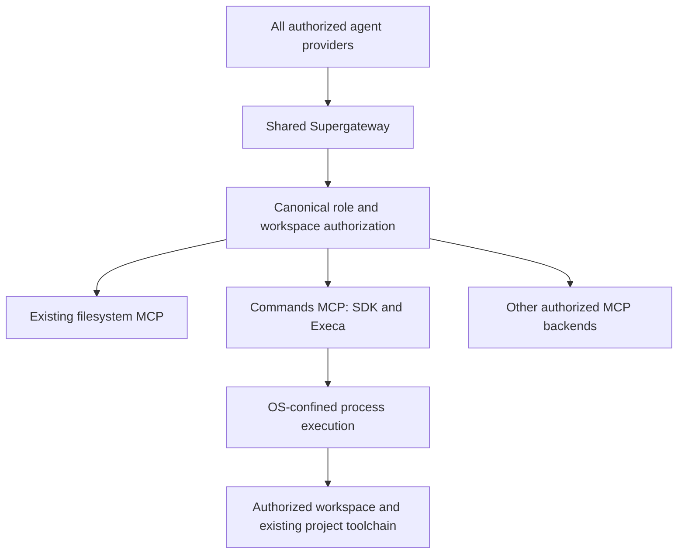

# Allowlisted Commands MCP — Design and Migration Plan

> **Status:** Source implementation audited against every requirement and acceptance criterion in this plan on 2026-11-26 (see [Acceptance audit](#acceptance-audit-2026-11-26)): the unit, integration, real-OS confinement, task-store and gateway-pool task suites pass locally (75 tests), and the gaps the audit found are fixed in source. **Not deployed:** the installer has not been run and no catalogue digest is approved, so live gateway, provider, telemetry, installer-reconciliation and Console acceptance remain open, as do the residuals the audit lists as blocked.
>
> **Authority:** [AutoDev unified target state](autodev-console-target-state.md#allowlisted-command-execution) owns durable architecture and authorization requirements. This focused subsystem plan explains the rationale, proposed implementation, migration order and acceptance gates. Record observed deployment evidence in [the migration tracker](autodev-console-migration.md), and operational instructions in [local setup](local-setup.md) when implemented.

## 1. Problem and decision

ChatGPT and other agents using the shared MCP gateway can inspect and edit workspace files but need a provider-independent way to execute approved deterministic development operations. For example:

```sh
pnpm install --no-frozen-lockfile
pnpm run typecheck
pnpm test
pnpm run lint:fix
git status
git diff
git add .
git commit -m "..."
```

Requiring XACPX to allocate another model for every such operation introduces latency, cost, provider availability dependencies and unnecessary inference. It can prevent completion of straightforward work such as regenerating a lockfile or running regression checks. XACPX remains the exclusive agent-delegation interface, not a command runner.

**Decision:** Retain the official filesystem MCP and add a narrow, generic `commands` MCP using existing dependencies. Expose fixed, operator-authorized executable/argument definitions as distinct MCP tools through the mandatory shared Supergateway. Do not adopt DesktopCommanderMCP or an unrestricted shell MCP for this use case.

### Alternatives considered

| Approach | Benefits | Costs and decision |
| --- | --- | --- |
| DesktopCommanderMCP replacing filesystem | Maintained TypeScript project; filesystem, search, interactive terminal and background process management in one backend | Different file schemas/edit semantics; command blocklist rather than proven exact argv grants; extra configuration, process ownership and confinement work; larger surface. Not selected. |
| Separate third-party allowlisted shell MCP | Potentially less first-party registration code | Evaluated candidates have limited adoption, maintenance or authorization/lifecycle fit; generic shell tools require additional parsing and enforcement. Not selected absent better evidence. |
| SDK + Execa, retain filesystem | Reuses maintained dependencies and existing authorization; distinct named tools; no new shell parser or task runner | Requires a thin domain-specific integration and proof of lifecycle/confinement. Selected. |

Dependency-first development means minimizing owned implementation, not adding a dependency merely to avoid a small composition layer. Avoid reimplementing subprocess handling, MCP transports, schema validation, telemetry or agent orchestration.

## 2. Target state and boundaries



The same role and workspace receive the same semantic command capabilities across providers and enrolled desktop, IDE, standalone CLI and web interfaces, whether Runtime-initiated or externally initiated. See the canonical [unified client integration target](autodev-console-target-state.md#unified-desktop-ide-cli-and-external-agent-integration). ChatGPT is not a special execution path. The backend does not require an AI provider or delegation to execute a command. There is no direct-provider connection or unsandboxed fallback.

| Responsibility | Owner |
| --- | --- |
| Task bodies | Existing project configuration (e.g. package.json scripts, Makefile) |
| Approved executable/argv definitions | One operator-controlled command catalogue |
| Roles, workspace grants, revocation | Canonical Runtime execution contract and authenticated ingress |
| Backend declaration | RuleSync MCP catalogue |
| MCP protocol, discovery, task primitives | Official MCP TypeScript SDK |
| Process execution and cancellation | Execa |
| Schema validation | Zod |
| Transport and routing | Supergateway |
| Filesystem, process, network and credential confinement | Existing OS sandbox infrastructure, generalized where necessary |
| Observed execution | Existing OpenTelemetry/OpenLIT pipeline |
| Installation, health, reconciliation | Runtime installer and existing MCP management surface |
| Agent delegation | XACPX, unchanged |

Retain `@modelcontextprotocol/server-filesystem` as the file-interaction surface. The new command tools are not a substitute for reading/editing files through that interface. This migration does not by itself require removing provider-native shell tools; they remain subject to the existing execution contract.

## Implementation status (2026-11-25)

The Commands MCP is implemented, integrated and tested at the source level. It
is **not deployed**: the installer has not been run, so the installed tree, the
launchd services and the live provider surfaces still carry the previous state.

### What exists now

- `config/commands.json` is the **proposed** catalogue and the single source
  of truth for executable/argv definitions. The installer copies it beside the
  execution contract in each Runtime home that runs a Commands MCP
  (`$AUTODEV_HOME/config/commands.json` for provider sessions,
  `$CODEX_HOME/config/commands.json` for the ChatGPT gateway) only when the
  operator approved that exact revision on the installer's command line
  (`--approve-command-catalogue=sha256:<digest>`, never from `.env`; see
  `runtime/src/platform/command-catalogue-approval.ts`); a changed checkout
  catalogue is reported as pending by the installer and `install-check` and
  never approved by a reinstall. The approved copy is never read from a
  workspace. Until `$CODEX_HOME` holds an approved copy, the ChatGPT gateway
  leaves the Commands backend out (the installer says so) instead of failing
  its preflight; the approved revision is part of the gateway's policy digest,
  so approving one re-reviews the grants. Gateway backends run from the
  installed `$CODEX_HOME/src` generation, never from the checkout the
  installer was started from.
  `runtime/src/mcp/commands-catalogue.ts` validates it: bounded fixed
  executable and argv, at most 64 definitions, narrowly typed string
  parameters, and no parameter that no argument uses or argument that names no
  parameter. Every reading of a catalogue file -- the approved copy the
  backend serves and the proposal the installer offers for approval -- goes
  through `parseCommandCatalogueText`, which also refuses a key declared twice
  in one object: `JSON.parse` silently keeps the last of two equal keys, so the
  definition an operator reviewed could otherwise differ from the one granted.
- A parameter replaces a **whole** argument element and is never spliced into
  one. `git_commit` declares `args: ["commit", "-m", "{message}"]` with a
  `message` parameter bounded to 1..500 characters; the value reaches `git` as
  one literal argument, so a message containing `; rm -rf /` is text, not
  syntax. Nothing is ever handed to a shell.
- `runtime/src/mcp/commands-execution.ts` owns the confinement. Each command
  runs under its own macOS Seatbelt profile: default-deny, no Mach services,
  no host IPC, no network, reads limited to the workspace, the Runtime's own
  scratch and cache roots and the reviewed toolchain, and writes limited to
  the workspace and those two roots. `.env*`, `.npmrc`, `.netrc`,
  `.git-credentials`, `.ssh`, `.aws`, `.gnupg`, `.codex` and `.autodev` are
  denied by path even inside the workspace. Every descendant inherits the
  profile, so a repository script cannot widen it. The child environment is
  constructed from scratch: `HOME`, `TMPDIR` and the cache root point at
  Runtime-owned private directories, `PATH` holds only the approved toolchain
  directories and the workspace's own `node_modules/.bin`, and no operator
  secret, tunnel token or provider credential is inherited.
- **A command that commits is attributed to the agent that made it.** Git
  reads no host configuration at all in a confined command: `GIT_CONFIG_NOSYSTEM`
  is set and `GIT_CONFIG_GLOBAL` points at `/dev/null`, so the operator's
  global configuration -- which names credential helpers, commit templates and
  aliases outside every workspace -- is neither readable nor inherited. The
  commit identity is the Runtime's own bounded agent identity
  (`gitCommitIdentityEnv`, the same one every other AutoDev agent path commits
  under), passed in the environment. Without it Git finds no identity at all
  and refuses to commit, so the identity is what makes `git_commit` work
  rather than a convenience layered on top of it. `GIT_TERMINAL_PROMPT=0`
  keeps a confined command from waiting on a credential prompt it can never
  answer.
- **Trusted executables resolve to something that can actually run.** macOS
  ships several tools as dispatch stubs: `/usr/bin/git` is a small binary that
  loads the developer toolchain to find the real tool, and a closed sandbox
  denies that load. `resolveTrustedExecutables` therefore resolves a stub to the
  developer directory's own binary, so the confined command runs the real tool
  and the profile can name the developer toolchain as a read-only root. The
  stub's own `/usr/bin` is not enough: Git also reads its system
  configuration from the developer directory.
- **Dependency installation works, with real egress control.** Seatbelt cannot
  restrict an outbound connection to a host, only to a port, so
  `runtime/src/mcp/commands-registry-proxy.ts` runs a trusted loopback proxy
  that serves package metadata and tarballs for one approved registry, refuses
  every other path (including npm's audit and ping endpoints), forwards no
  credentials, and rewrites the metadata's tarball URLs back to itself. The
  confined command may open exactly that one loopback port and nothing else.
  The package store is per workspace, so one workspace cannot poison another's
  cache.
- `runtime/src/mcp/commands-server.ts` registers one native SDK task tool per
  approved command. The effective tool set is the intersection of the
  approved catalogue, the canonical role contract
  (`mcpTools.commands`) and the workspace's eligibility. The SDK's session
  binding is preserved on every store operation, so a task created in one
  session is not found by another **when the SDK sessions are distinct**.
  This does not prove isolation across frontend conversations pooled into one
  backend transport. A grant is rechecked before lifecycle operations and
  every 250 ms while an invocation is active. Once revocation is observed,
  that server's grant cannot recover; active invocations are aborted and
  revoked results are not served. Cancellation and lease release wait for
  subprocess settlement; detached descendant cleanup still requires host
  qualification. The task store is durable
  (`runtime/src/mcp/command-task-store.ts`), so an interrupted command is
  reconciled as failed rather than lost.
- `runtime/src/mcp/commands-main.ts` is the stdio entry point. It resolves the
  role and workspace from the trusted launcher's arguments or environment,
  refuses to start when the approved catalogue resolves **inside** the
  authorized workspace (an agent that can edit its own authority is not a
  trusted authority), provisions private scratch, cache and task-record roots
  outside the workspace, and takes a
  workspace-wide exclusive lease so two sessions cannot race over the same
  build outputs. The lease records the process that holds it and the command
  it was taken for, so it is never taken over on the basis of its age: it is
  taken over only when that holder and that command are both gone, and
  anything it cannot prove fails closed. An operator can inspect and release
  a lease with `autodev lease list` and `autodev lease release`. The approved
  catalogue read refuses final-file symlinks, multiple hard links, and
  non-owner/group-or-other-writable files. The parent directory and installed
  Runtime still require an independently protected trust boundary.
- Integration: `runtime/src/mcp/launcher.ts` serves the backend,
  `runtime/src/mcp/chatgpt-filesystem-sandbox.ts` gives it its own gateway
  confinement, `.rulesync/mcp.jsonc` declares it once for both the portable
  and the Codex projection, and `agents/roles/{orchestrator,worker,validator}.toml`
  grant it. `config/execution-contract.json` is regenerated from those role
  files by the canonical renderer. The orchestrator and worker hold
  `install_dependencies`, `typecheck`, `test`, `lint_fix`, `git_status`,
  `git_diff`, `git_stage` and `git_commit`; the validator holds `typecheck`,
  `test`, `git_status` and `git_diff`. No role holds `git push`, `git reset`,
  `git config`, `git rebase` or `git clean`, and no read-only role holds a
  command at all.
- `runtime/tests/command-workspace-lease.test.ts` covers the workspace lease:
  that it is exclusive across sessions and released on completion, that it is
  never taken over on the basis of its age, that it is taken over only when
  its holder and its command are both gone, that a lease whose command is
  still running, whose command was never recorded, or whose record cannot be
  read is never taken over, that a replaced run directory is never used, and
  that the operator sees each lease's state and releases only what is
  provable.
- `runtime/tests/commands-mcp.test.ts` covers catalogue strictness, parameter
  validation and literal substitution, role grants and denials, workspace
  eligibility, the protected-catalogue rule, revocation,
  the network and credential profile, trusted executable resolution, the
  registry proxy's path classification and URL rewriting, and -- as real
  macOS confinement tests -- literal argument handling, denial of writes
  outside the workspace, denial of `.env` reads, refusal to follow a symlink
  out of the workspace, timeout, cancellation, output truncation and the
  privacy of the scratch and cache roots. A positive control asserts that the
  host's `sandbox-exec` really confines, so the negative tests are not
  vacuous.
- `runtime/tests/commands-mcp-integration.test.ts` starts the real server over
  MCP stdio and drives it as a client would: tool discovery matches the
  role's grant exactly, a narrower role sees only its own commands, a
  read-only role is refused the surface entirely, the server refuses to start
  when the approved catalogue resolves inside the workspace, the native task
  lifecycle creates, polls, lists and yields a result for an augmented call,
  output is bounded with the observed exit status, the private roots are
  owner-only, and a commit made through the surface carries the agent's own
  identity in the commit itself.

### Parallel review checkpoint (2026-11-25)

Additional source changes in the command subsystem correct discovery readiness
to report only successfully registered tools, use conservative mutation hints
for repository-controlled validation scripts, add bounded active revocation
checks, close the stdio backend and its registry proxy on graceful shutdown,
and remove time-only lease takeover. The registry proxy accepts scoped npm
package paths, rejects query strings, request bodies and redirects, bounds
active requests and response sizes, and streams tarballs instead of buffering
them. New regression fixtures cover these boundaries; these changes have not
been run through the local test suite or installed gateway. The independent
operator approval boundary, production nested sandbox/registry egress,
cross-conversation task ownership, durable recovery, and detached descendant
cleanup remain open.

A second parallel pass uses the catalogue's Zod input schema for both
SDK discovery and literal argv validation, bounds catalogue size and
parameter count, and resolves only executables relevant to the admitted
role/workspace. Command workspace keys now use physical paths; the
admission callback also checks the original directory identity, revoking
a scope when its physical root is replaced. This closes alias-key
duplication, not all overlapping-workspace or path-replacement races.
Dependency installation requires an exact root HTTP IPv4-loopback registry
endpoint. Ordinary request cancellation propagates through the native SDK
request signal to the existing process abort controller.

Command execution spans reuse the MCP telemetry initializer and OTLP
configuration, with the producer identity `autodev-commands-mcp`.
They record one internal `command.execute` span per attempted invocation
with bounded command identity, execution class, duration, observed exit
code, terminal outcome and truncation, without a second MCP tool-call
observation or arguments/output/error-message export. The backend does
not broaden sandbox network access for telemetry; an allowed collector
path, actual export, correlation and Console observations need production
qualification. There is no admission queue in this implementation; do not
fabricate queue-time observations. Regression fixtures are written but
not executed in this pass.

A third parallel pass tightens the native task store's transport-session
binding. The SDK treats an omitted session identifier as a wildcard; the
backend now normalizes omitted and explicit identifiers to disjoint,
nonempty keys for every store operation, including result writes and
cancellation. Shutdown callers share one settlement promise, and a grant
is rechecked after asynchronous task creation before any command starts.
Stored tool results use the SDK's own schema instead of a handwritten cast.
This does not authenticate frontend conversations multiplexed onto one
stdio transport.

The scratch/cache directory creation logic is shared and refuses invalid
workspace keys, redirected directories and non-private permissions.
Catalogue reads are bounded to 1 MiB, including concurrent growth. The
command sandbox's broad Runtime-state deny now excludes precisely the
admitted scratch and cache roots, without relaxing credential denies or
granting sibling state access. The macOS fixture exercises this actual
layout; execution under the host Seatbelt remains to be verified.

The registry proxy now rewrites only package metadata's `dist.tarball`
fields (including version records) whose URL has the exact approved
registry origin and allowed tarball path. Other metadata is preserved.
Caller header values are not forwarded, malformed JSON is rejected, and
listener connections, header/request timeouts and response inactivity
are bounded. This does not qualify the outer gateway network policy or
eliminate the inherent outbound package-name request channel.

All changes in this pass have source regression fixtures, not executed
host test evidence. No additional dependency or service was introduced.

### Shared path and approval consistency (source review)

Command execution and catalogue admission now reuse Data's existing lexical path containment helper; physical resolution remains with the callers. Installer approval status uses the same bounded protected-catalogue reader and Zod validation as the Commands backend, rather than treating matching digests alone as readiness. Both reject a redirected config directory; explicit approval refuses a symlinked destination before invoking the existing atomic-write dependency. This assumes the installed parent is independently protected against concurrent untrusted writes, and is not a substitute for that trust boundary. New regression fixtures cover approval status, redirected destinations and symmetric overlap. Tests and installed acceptance remain pending.

### Executable availability and PATH consistency (source review)

The command resolver now uses the catalogue's Zod executable-name schema and
omits missing or invalid executable files without blocking independent tools.
The server reports unavailable eligible command IDs on stderr and does not
start a registry listener for a dependency-install definition whose executable
is unavailable. An admitted Runtime Node directory precedes workspace tool
shims in the confined PATH; OS binaries also precede workspace shims. No
additional filesystem roots, dependencies or fallback executables are granted.
Regression fixtures cover partial executable availability, invalid dot names,
scope resolution and PATH precedence. Local execution remains pending.

Workspace-wide admission still needs to converge on one trusted state root:
`autodevRunDirectory()` can use `CODEX_HOME` in gateway launches and
`AUTODEV_HOME` in managed launches. Independent locks in those homes do not
prove cross-provider exclusivity. Resolve this with shared gateway ownership,
not a second locking mechanism.

### Command state admission (source review)

The resolved command scope now owns the physical run-directory path used
for its workspace lease, scratch and cache; startup no longer accepts a
second independent run-directory argument. One directory-validation helper
checks ownership, type and write permissions. The physical run path is
checked for workspace overlap before provisioning, including aliases of
existing ancestors. Symlinked run-directory leaves are rejected, and the
admitted run, scratch and cache identities are checked during authorization.
Lease acquisition and release refuse a replaced run directory. The checks
assume trusted installed parent directories; they are not a race-free
replacement for OS confinement. Regression fixtures cover redirected
roots, writable state, replaced run/scratch directories and physical
workspace overlap. Local test execution remains pending. The shared
gateway cutover still must establish one state home across all providers.

### Acceptance audit (2026-11-26)

Every requirement and acceptance criterion in sections 4-12 was checked
against the source and by executing the suites, not by reading earlier status
notes. Command (from `runtime/`):

```sh
pnpm exec node --import ./tests/support/isolate-autodev-state.ts --test \
  tests/commands-mcp.test.ts tests/commands-mcp-integration.test.ts \
  tests/command-task-store.test.ts tests/command-process-tree.test.ts \
  tests/command-network-boundary.test.ts tests/control-api-commands-approval.test.ts \
  tests/backend-pool-tasks.test.ts
```

Result: 75 tests, 75 pass, 0 skipped, on macOS with the real `sandbox-exec`.
Also run: `tests/platform/command-catalogue-approval.test.ts` (7 pass),
`runtime/tests/execution-contract-render.test.ts` (2 pass), and
`node runtime/src/cli/autodev.ts render contract --output config/execution-contract.json --check`
(no drift; orchestrator and worker hold the eight commands, validator holds
`typecheck`, `test`, `git_status`, `git_diff`; no read-only role holds any).
`tsc --noEmit` reports no errors in the Commands files. Test names below are
the evidence.

#### Fixed by this audit

| Criterion | Gap found | Fix and evidence |
| --- | --- | --- |
| Valid/invalid catalogue, **duplicate names** -> actionable rejection | `JSON.parse` silently kept the last of two equal keys in both the backend's approved-catalogue read and the installer's approval read, so a reviewed definition could differ from the granted one | `parseCommandCatalogueText` rejects any key declared twice in one object (`DUPLICATE_CATALOGUE_KEY`), used by `commands-main.ts` and `command-catalogue-approval.ts`. Tests: "a catalogue that declares one key twice is rejected, not silently resolved", "an approved catalogue that declares a key twice grants nothing", "a proposal that declares a command twice is never offered for approval" |
| Exit codes and **startup failure** -> truthful distinct outcomes; missing executables distinguishable from infrastructure errors | An executable that vanished after admission was reported as a generic `infrastructure_error` | `prepareCommand` raises `CommandExecutableUnavailableError`; the result is `startup_failure` with `exitCode: null`. Test: "an approved executable that disappeared is a startup failure, not a command that ran" |
| Native task status semantics | A non-succeeded command made a `failed` task whose result did not set `isError`, so the result and the task disagreed | Non-succeeded results carry `isError: true`. Test: "a command that fails is a failed task, and never a completed one" |
| Excess output/expired retention -> bounded storage, **secure cleanup** | A backend that died between writing and renaming a record left a `.tmp` file holding a result body forever | Reconciliation removes temporary records whose writer process is gone and keeps a live writer's. Test: "a partial record a dead backend left behind is removed, a live writer's is kept" |
| Access **host IPC** -> denied | Only asserted on the profile text | Real-OS test with a positive control: "a confined command cannot reach a host IPC service" (`notifyutil` answers on the host and fails under the profile; adding `(allow mach-lookup)` makes it answer, so the test can go red) |

#### Verified

| Criterion | Evidence (test names) |
| --- | --- |
| Registration/discovery: only effective named definitions | "a client discovers exactly the commands its role holds, and runs one"; "a role with a narrower grant sees only its own commands"; "registered commands match discovery, ..."; "a command may be restricted to the workspaces it names" |
| Extra input, executable, argv, cwd, env overrides rejected before subprocess | "parameters are validated, substituted literally, and never interpolated"; "the catalogue is strict, and a parameter is only ever a whole argument" |
| Trusted executable resolution; PATH/workspace shadowing denied | "trusted executables never resolve out of the workspace"; "the confined PATH prefers an admitted Runtime Node over workspace shims" |
| Shell interpolation | "a confined command keeps literal arguments, ..." |
| Output bounds | "output beyond the bound is reported as truncated ..."; "a command's output is bounded and its exit status is the observed one" |
| Deadline and cancellation | "a command that outlives its deadline is stopped and reported as timed out"; "a cancelled command is stopped and reported as cancelled"; "registered commands match discovery, and request cancellation and revocation stop execution" |
| Env filtering | "a command's environment carries no operator credentials and no host paths"; "a confined command cannot read the operator's Git configuration" |
| Concurrent requests: workspace serialization | "a workspace lease is exclusive across sessions and released on completion"; "an old lease is not proof that its command stopped"; "a lease whose holder and command are both gone is taken over"; "a lease whose command is still running is never taken over". Busy admission is rejected, not queued (no queue exists, so no queue time is observed) |
| Configuration drift | execution-contract `--check` above; "the installed catalogue is a valid, generic catalogue"; approval suite |
| Unlisted command, unknown role, read-only role | "a read-only role is refused the command surface entirely"; "a role's grant decides the effective command set, ..." |
| Traversal and symlink escape | "a symlink in the workspace cannot be used to reach outside it"; "the admitted command workspace cannot be redirected after scope resolution"; "workspace keys are physical, ..." |
| Replace executable or edit effective policy; no self-escalation | "replacing the approved catalogue revokes the grant"; "approved catalogue reads reject symlinks, shared hard links and writable modes"; "the server refuses to start when the approved catalogue is inside the workspace"; "an agent's edit to the checkout catalogue is not approved by a reinstall" |
| Workspace is AutoDev's own checkout | "a command in AutoDev's own checkout cannot change the effective policy" |
| Read secrets, write outside workspace | "a confined command keeps literal arguments, cannot write outside the workspace and cannot read secrets"; "confined commands can use private Runtime roots without reading sibling Runtime state" |
| Unauthorized network | "a confined command reaches the registry proxy's port and nothing else"; "only a dependency install may reach the network, and only the registry proxy" |
| Descendant escape and detached descendants | the four `command-process-tree` tests |
| Shared cache cross-contamination | "two workspaces never share a writable cache" |
| Revoked or forged grant | "a command whose grant ends mid-flight is failed, not left running"; "the task store refuses every operation once the grant is revoked" |
| List/read/result/cancel another session's task | Backend: "the task store isolates explicit and absent transport sessions". Gateway pool: "a task is visible only to the session or conversation that created it" |
| Sandbox available and really confining | "the host's sandbox tooling really confines, so the negative tests mean something" |
| Short command; long command as native task | "the native task lifecycle is available to a client that drives it" |
| Pool reaping, idle and session timeouts | "native task handles retain their backend past idle and unrelated RPC timeout"; "a retained task prevents conversation eviction until its retention expires"; "a native terminal status notification releases retention without a client poll" |
| Crash/restart: no false completion or replay | "a task whose backend ended is failed, never completed, and is not replayed"; "a finished task keeps its result ..."; "a live backend's task is not reconciled by a sibling backend"; "a command that is still running when the backend closes is failed, never completed" |
| Duplicate/uncertain submission | "an uncertain task creation is not treated as idle or safe to retry"; no automatic retry exists in the backend |
| Bounded retention | "the task store is bounded by count and by retention"; "the task store's records are private to their scope" |
| Commit attribution (temporary repository) | "a commit made through the command surface is attributed to the agent" |
| Execution spans without content | "command execution spans reuse the MCP tracer without double-counting or leaking command content" |
| Approval state on `/control/mcps` | the four `control-api-commands-approval` tests |

#### Blocked

| Criterion | Reason |
| --- | --- |
| Gateway and provider acceptance (ChatGPT ingress, Codex, Claude, Antigravity, MiniMax Code, Copilot, OpenCLI ChatGPT/Gemini); concrete ChatGPT development scenario | Needs an installed deployment: the installer restarts launchd services and needs the operator's authorization, and the ChatGPT gateway serves no Commands backend until the operator approves a catalogue digest. Not done here by constraint |
| Native task negotiation through Supergateway, tunnel and real clients; client disconnect/reconnect over the live gateway | Same: requires the installed gateway. The pool and backend behaviour is proven in source tests only |
| Metrics (counts, latency, active work, denials, cleanup) | No meter exists in the shared MCP telemetry owner (`runtime/src/mcp/mcp-telemetry.ts` has spans only); adding one is a shared-telemetry change outside this subsystem, and collector reachability from the confined backend is unqualified |
| Installer reconciliation, rollback, health and Console MCP management live | Installed-state evidence; the source surfaces are tested (approval suite, `/control/mcps` publication) |
| Mount escape | Not testable without privileged mount creation; covered only by physical-path canonicalization and the default-deny profile |
| `sandbox-exec` exec failure after admission | `sandbox-exec` exits 71 when it cannot exec the approved executable, which a command can also exit with, so a failure in the microseconds between `prepareCommand`'s check and the exec is reported as `failed` with exit 71 rather than `startup_failure` |
| Retention limit shared across sessions | The 32-task bound is per role/workspace scope, not per session, so one session can fill it and make another's submission fail with "retention limit reached" until records expire. Fails closed; fairness needs per-conversation identity the backend does not receive (the pool owns it) |
| Hostile registry body; detached descendant whose parent exits between sweeps; one state home across providers | Residuals already recorded in section 13 and "Command state admission" |

### What is still open

- **Deployment.** The installer has not been run. A normal install restarts
  `com.codex.model-router`, `com.codex.opencli-proxy`,
  `com.codex.autodev-console`, `com.codex.autodev-chatgpt-tunnel` and
  `com.codex.autodev-mcp-gateway`, so it needs the operator's explicit
  authorization; that authorization was requested and has not been given, so
  the installer was left unrun rather than run on an unanswered question. The
  installed tree, the launchd services, the Supergateway projections and the
  live provider surfaces therefore still carry the previous state, and no live
  acceptance has been performed. The ChatGPT gateway additionally needs
  `--approve-command-catalogue=sha256:<digest>` for the approved revision it
  publishes, so the catalogue's digest is part of the deployment, not a
  source-tree detail.
- **Task durability.** The SDK's in-memory store is no longer used.
  `runtime/src/mcp/command-task-store.ts` implements the SDK's own `TaskStore`
  extension point over the Runtime's private run directory
  (`<Runtime home>/run/command-tasks/<role>-<workspace>`), one atomically
  replaced record per task. A task that was still running when its backend
  ended is reconciled as **failed**, with the reason, and is never reported
  as completed and never replayed; a task that had already finished keeps
  its result, so a client that reconnects can still collect it. Records are
  bound to the session that created them, bounded by count and by retention,
  and the directory is private to the scope. The interruption is proven through
  the real confined executor: a backend that closes with a command still
  running, and a grant that ends mid-flight, both leave a task that reads back
  as failed with an unknown outcome rather than as completed. What is still
  open is the installed evidence: no deployed Runtime has been restarted under a
  running command yet.
- **Console and Control API surfaces.** The approval state of the catalogue
  each Runtime home serves is published on the Commands backend's own MCP
  entry in `/control/mcps` -- `approved`, `pending`, `unavailable` or
  `unknown`, with both digests -- and the Console's MCP detail renders it per
  home. The remaining states are carried by the existing reads: the
  declaration by `/control/mcps`, the applied projection by
  `/control/mcp-applied`, and the Runtime's observations by
  `/control/mcp-runtime`. What is still open is the live evidence: the
  surfaces exist and are exercised by tests, but no installed deployment has
  published them yet.
- **Telemetry.** Source-owned execution spans now use the existing
  OpenTelemetry pipeline. Installed collector reachability, actual export,
  correlation with gateway observations, bounded metrics and Console
  consumption are not yet verified. The backend rejects busy admission
  rather than queueing it; queue latency is not observed.
- **Cross-workspace trust.** The approved catalogue is protected by being
  outside every workspace and by the refusal to start when it is not. That is
  enforced, and the case where the workspace _is_ AutoDev's own checkout is
  designed for explicitly (see "The workspace is AutoDev's own source
  checkout" in section 13). What remains is that this is a property of the
  deployment layout rather than a cryptographic binding of the executable
  resolution to a reviewed revision.

## 3. Dependency and protocol qualification

Inspect the actual manifests, lockfile, installed declarations and source before implementing; do not assume a newer upstream release's behavior. The investigated checkout declared `@modelcontextprotocol/sdk` ^1.32.2, `execa` 10.2.1, `zod` ^4.6.7 and `supergateway` 4.2.2. OpenTelemetry and Rulesync are already present. These observations are not additional version pins.

Primary reference points:

- [Official MCP TypeScript SDK](https://github.com/modelcontextprotocol/typescript-sdk)
- [MCP Tasks extension](https://modelcontextprotocol.github.io/ext-tasks/typescript/)
- [Execa](https://github.com/sindresorhus/execa)
- [Supergateway](https://github.com/supercorp-ai/supergateway)
- [Desktop Commander](https://github.com/wonderwhy-er/DesktopCommanderMCP) and its [security guidance](https://github.com/wonderwhy-er/DesktopCommanderMCP/security)

Source observations during planning:

- Installed SDK declarations expose experimental `server.experimental.tasks.registerToolTask` and in-memory task-store/message-queue implementations. These do not establish production durability or actual client compatibility.
- `runtime/src/mcp/chatgpt-backend-pool.ts`, which now serves every gateway member, recognizes tasks/get, tasks/list, tasks/result and tasks/cancel. Forwarding methods alone is not proof of negotiation, ownership, cancellation or correct lifetime.
- Existing filter deadlines were 60 seconds for tools/call and 15 seconds for other requests; external gateway session timeout defaults to 60 seconds. Inspect the effective backend idle/transport/tunnel deadlines before implementing. Do not duplicate them as new configuration.
- The existing macOS filesystem sandbox permits a narrow Node execution environment, not arbitrary pnpm descendants. It must be evaluated and adapted rather than assumed to confine a command service.
- Conversation-specific authorization for shared external MCP sessions remains an existing integration concern. A static coordinator ID, browser conversation ID, opaque task ID or unverified request metadata is not sufficient authority.

Verify Node and native dependency compatibility, supported protocol versions, task capabilities, Execa API options and termination behavior, licensing and release/security posture. Prefer existing public APIs. If a capability gap needs a new dependency, qualify it under the canonical dependency policy before adopting it.

## 4. Declarative catalogue and tool interface

Design one validated command catalogue. Its exact location, serialization format and schema are implementation decisions; reuse existing configuration and revision/reconciliation machinery rather than introducing a competing authority. Each definition identifies a tool, description, fixed executable and argv, maximum runtime, execution class, workspace constraints and concurrency policy. Environment and network permissions are server-owned, not model-supplied.

Illustrative YAML (not currently supported configuration):

```yaml
version: 1
commands:
  install_dependencies:
    description: Install dependencies and regenerate the lockfile.
    executable: pnpm
    args: ["install", "--no-frozen-lockfile"]
    timeoutMs: 600000
    executionClass: dependency_install
    concurrency: exclusive
  typecheck:
    description: Run project type checking.
    executable: pnpm
    args: ["run", "typecheck"]
    timeoutMs: 300000
    executionClass: validation
    concurrency: exclusive
  test:
    description: Run the regression suite.
    executable: pnpm
    args: ["test"]
    timeoutMs: 900000
    executionClass: validation
    concurrency: exclusive
  lint_fix:
    description: Apply automated lint corrections.
    executable: pnpm
    args: ["run", "lint:fix"]
    timeoutMs: 300000
    executionClass: workspace_mutation
    concurrency: exclusive
```

Calibrate these provisional maximum durations using observed runs. They are not a mandate to weaken test performance thresholds. Configuration must be generic enough to express e.g. uv run pytest, cargo check --workspace or make build without changing server code. Project-declared scripts are untrusted candidates, not automatic grants.

Project scripts remain single-sourced; the command definition references the task instead of copying its body. A change to a task's implementation should not require a corresponding content edit to tests or prompts. Authorization of the invocation does not imply that any modified script is safe; confinement is mandatory.

Register each command through the SDK as an individually discoverable named MCP tool. Use the existing gateway namespace conventions. Initial tools accept an empty strict input object; reject extra input rather than ignore it. The server resolves workspace, executable, argv, environment and policy from trusted context. Do not expose a generic execute(command, args, cwd, env) tool, shell string, arbitrary stdin or PID manipulation.

Return structured results using native MCP structured content and task contracts where applicable. Example:

```json
{
  "commandId": "typecheck",
  "status": "failed",
  "exitCode": 2,
  "durationMs": 18432,
  "stdout": "...",
  "stderr": "...",
  "outputTruncated": false
}
```

Implemented statuses: `succeeded`, `failed` (observed nonzero exit), `timed_out`, `cancelled`, `output_limit`, `startup_failure` (the approved executable vanished after admission; no process ran and no exit status is claimed) and `infrastructure_error` (confinement or spawn failure, with a fixed message). Grant denials, busy workspaces and invalid parameters are refused before a task exists. A task whose backend ended mid-command is `failed` with an explicitly unknown outcome. Every non-succeeded result carries `isError: true` and its task is `failed`, so result and task status agree.

Specify schemas and status semantics consistently. An ordinary failed test is a completed command with a nonzero exit status, not a transport failure. Permission denials, missing executables and infrastructure errors are distinguishable. Do not claim an exit status that was not observed. Expose accurate tool annotations; validation commands are not intrinsically read-only or idempotent.

## 5. Process execution

Use Execa's public executable-and-argument-array interface, not a shell parser. Conceptual implementation:

```ts
const result = await execa(resolvedExecutable, definition.args, {
  cwd: authorizedWorkspace,
  shell: false,
  extendEnv: false,
  env: authorizedEnvironment,
  timeout: definition.timeoutMs,
  cancelSignal: signal,
  reject: false,
  maxBuffer: configuredOutputLimit
});
```

Verify option semantics against installed Execa. This example is not a sandbox or complete lifecycle implementation. Resolve the executable via the existing trusted toolchain resolver, not caller PATH or a workspace-controlled executable. Handle subprocess output with bounded streaming/buffering; truncation or termination must be explicit and avoid memory/disk exhaustion. Prefer dependency-provided cancellation and output facilities; only add integration logic where the existing APIs demonstrably require it.

Enforce a total runtime deadline including queueing where appropriate, a bounded execution/queue budget, sanitized child environment, approved cwd, reliable exit status and descendant-process cleanup. Serialize mutually interfering operations per workspace (installs, mutations, validation sharing build outputs); reuse existing concurrency facilities where applicable. Separate unrelated workspaces where safe.

Do not retry a mutating command or an uncertain submission automatically. On failure distinguish rejected, startup failure, nonzero exit, timed out, cancelled and uncertain outcomes. Retain uncertainty when completion or termination cannot be established.

## 6. Security and authorization

**A fixed command allowlist is not an execution sandbox.** pnpm test executes repository code, and pnpm install can execute package lifecycle scripts. An agent with write access can alter package scripts, dependencies, hooks or test files before running an approved invocation. Constrain every descendant independently of command text.

Enforce all of these boundaries:

- Discovery and invocation: grant only the intersection of operator approval, canonical role, workspace, command definition and supported runtime capability. Reauthorize before execution and on task operations. Deny unknown or revoked grants.
- Catalogue integrity: agents cannot widen their own grants by editing source configuration or invoking reload/reconciliation. If declarations live in an editable checkout, distinguish proposed declarations from operator-approved, protected effective policy. Bind authorization to the approved revision and protect the materialized policy, executable resolution, launcher and privileged Runtime code against replacement or TOCTOU by the same principal. A writable AutoDev source checkout is not a trustworthy live security boundary.
- Workspace: bind cwd to trusted structured context; canonicalize paths and account for symlinks, mounts and overlapping workspaces. No caller-controlled cwd or environment.
- OS confinement: generalize existing Seatbelt/host confinement where proven. Deny writes outside authorized workspace and explicitly scoped scratch/cache areas, and deny reads of protected secrets, unrelated repositories and host credentials. Control subprocess and IPC access, signaling and escape paths. If confinement cannot be established, fail closed.
- Environment: construct a minimal allowlisted environment; do not inherit operator API keys, SSH agent sockets, cloud credentials, tunnel tokens, provider credentials or unrestricted host configuration. Keep secrets out of output, logs and telemetry.
- Network: deny by default for local validation and formatting; grant explicit network access for tests/builds only where required. Dependency installs need reviewed package-source access, registry authentication isolation and supply-chain controls. Do not claim domain-level enforcement if the underlying OS/network boundary cannot provide it. Protect shared caches from cross-workspace poisoning; isolate writable caches where necessary.
- Lifecycle: bind all task operations to trusted principal, role, workspace and authorized session/coordinator scope; task IDs alone never grant access. On revocation, prevent new calls and enforce a documented cancellation/result-access policy. Prevent unbounded background execution and orphaned descendants.

### Initial grants

Proposed policy only; reconcile with the actual canonical role contracts before exposure.

| Tool | Orchestrator | Worker | Validator | Explorer |
| --- | --- | --- | --- | --- |
| install_dependencies | Allow | Allow | Deny | Deny |
| typecheck | Allow | Allow | Conditional | Deny |
| test | Allow | Allow | Conditional | Deny |
| lint_fix | Allow | Allow | Deny | Deny |

A validator may run tests/typecheck only if its role explicitly authorizes the required writes, execution and confinement. No read-only role receives implicit executable access; no sealed playtest role receives a new file or command surface by implication. Other roles default to deny until reviewed. Provider choice never changes these semantics.

## 7. Long-running execution and native MCP Tasks

Use native task functionality where the installed SDK, gateway and actual client support it. Investigate the maintained official extension if the existing experimental implementation cannot meet the required contract. Do not build a parallel custom start/status/poll/result protocol as a shortcut.

Required lifecycle: authorized submission, bounded queue, execution, terminal result (success/nonzero exit/cancel/timeout or explicit uncertainty), bounded result retention and cleanup. Use native task status semantics rather than inventing a new transport schema.

The warm backend pool must account for tasks that remain running after the initial tools/call returns. It must not reap a backend with active tasks based only on the active request count. Reconcile task TTL, command deadline, transport request deadline, session expiry and idle reaping. Ensure task list/get/result/cancel are ownership-scoped, not merely forwarded by method name.

Source progress: the pool now pins native task handles through execution and observed terminal result retention, and prevents idle/LRU/timeout-driven reaping while pinned. Unknown creation outcomes fail closed; missing/expired records alone do not prove execution stopped. SDK task schemas and terminal-state semantics remain authoritative. Retention bookkeeping is bounded by count, but unknown or unlimited lifetimes require explicit recovery. This is not a task authorization store; actual session ownership, recovery, negotiation and live acceptance are still open.

Define disconnect/reconnect, cancellation, process crash, backend shutdown, Runtime restart and policy revocation behavior. In-memory stores do not provide restart durability. Choose explicit safe termination on restart or a proven recovery/reconciliation strategy using maintained facilities; never report lost tasks as completed or replay uncertain mutations. Retention and logs must be bounded by time and size.

Source progress: the chosen strategy is explicit safe termination with a durable record. The backend's own task store implements the SDK's `TaskStore` extension point over the Runtime's private run directory, so a task outlives the process that created it. A task that was still running when its backend ended is reconciled as **failed** with the reason, its result states that the outcome is unknown, and the command is never replayed. A task that had already finished keeps its result for a reconnecting client. Reconciliation is judged by the owning process: a live sibling backend's tasks are left alone, so a second backend never cancels a running command it does not own. Cancellation waits for the subprocess to settle before the task is reported as cancelled, and a backend that closes records its outstanding commands as failed rather than completed.

If native asynchronous operations are unavailable, synchronous calls may be enabled only when they fit the complete independently enforced request deadline and cleanup contract. Otherwise refuse with an actionable capability-gap diagnostic. Do not solve long commands solely by raising gateway timeouts. A provider that cannot support required operations remains a parity gap until live acceptance, not grounds for a direct connection or unsandboxed path.

## 8. Observability and operations

Use existing MCP spans and OpenTelemetry/OpenLIT correlation. Record command ID, provider/role/workspace context where authorized, duration, terminal outcome, exit code, timeouts, cancellation, queue time and output truncation. Metrics should cover execution counts, latency, active/queued work, denials, failures and cleanup outcomes with bounded dimensions. Do not add high-cardinality task/session IDs or arbitrary paths as metric labels.

Do not log command output, raw arguments, env or credentials by default. Command results themselves are sensitive workspace data and need the same access/retention constraints as other MCP responses.

Integrate backend configuration, applied revision, health, discovery, effective grants and disable/revoke controls with the existing MCP Console resource and authenticated Control API. Do not add a parallel dashboard or execution control plane. Reuse the existing installer, pinned pnpm toolchain, generated projections and drift checks. No runtime npx/npm fetching or provider-specific manual setup.

## 9. Integration points

Paths below are source-navigation starting points, not a mandate to create additional modules or duplicate existing owners. Inspect current files before editing.

| Area | Integration |
| --- | --- |
| runtime/src/mcp/ | Register and execute declarative command tools using SDK and Execa |
| runtime/src/mcp/launcher.ts | Launch backend through existing managed path |
| runtime/src/shared/tool-names.ts | Canonical commands server identity |
| .rulesync/mcp.jsonc | One canonical backend declaration |
| .rulesync/permissions.jsonc and agents/roles/*.toml | Portable and role-specific grants |
| config/execution-contract.json | Regenerate from canonical source, never hand-edit |
| runtime/src/shared/execution-contract.ts | Reuse effective role/workspace contract |
| runtime/src/mcp/chatgpt-backend-pool.ts | Discovery, invocation, task operation authorization; task lifetime, ownership, timeouts, isolation |
| runtime/src/config/render-chatgpt-supergateway.ts | Existing role-contracted gateway projections |
| runtime/src/mcp/chatgpt-filesystem-sandbox.ts | Reuse/generalize confinement; verify trusted executables and descendants |
| runtime/src/platform/ | Installation, health and reconciliation |
| console/ and existing Control API | Existing MCP resource for command availability, approval revision, effective grants, health and evidence; command definitions/permission policy remain repository-owned and read-only, not a new command-authoring product |
| tests/ and runtime/tests/ | Behavioral, isolation, security and acceptance coverage |

Do not expand the existing shell command classification/parser just to authorize fixed argv invocations. Do not duplicate an inventory in prompts, generated projections or tests. Derive role grants and provider projections from their owners.

## 10. Migration sequence and gates

1. **Qualify dependencies and requirements.** Verify the installed APIs, protocol negotiation, actual gateway and provider capabilities, command confinement and lifecycle limitations. Confirm one ownership model. Record blockers explicitly.
2. **Build narrow backend.** Validate catalogue, register strict named tools, resolve trusted argv/cwd/env, execute using Execa and return bounded results. Begin with harmless synthetic fixtures. No external ingress exposure yet.
3. **Enforce security.** Protect effective policy and live executable, bind trusted workspace/role/session, constrain descendants and credentials/network, enforce queue and output limits. Negative tests must pass before enabling any real mutation.
4. **Integrate shared gateway.** Add canonical declaration, role grants, launcher, projection and reconciliation. Verify no direct-provider backend routes. Start with explicit operator opt-in and least privilege; failure must not broaden grants.
5. **Prove native task lifecycle.** Test negotiated support, long commands, disconnect/reconnect, cancellation, task ownership, backend reaping, timeout and restart/revocation. Address capability gaps through public upstream interfaces. Do not label tasks supported based only on mocks.
6. **Operational integration.** Verify existing MCP management, health/reconciliation, telemetry, output redaction and retention. Record exact installation and rollback procedure in operational docs.
7. **Live acceptance and cutover.** Run initial real commands in an authorized test workspace, then through actual ChatGPT ingress and eligible native/browser providers. Verify denied roles/sessions. Remove only superseded paths proven redundant; retain filesystem MCP and XACPX's distinct responsibility.

Rollback: disable/revoke the commands backend through existing managed configuration, reject new submissions, cancel and reconcile outstanding tasks, preserve required diagnostic evidence, regenerate/reconcile provider projections, verify absence from discovery and denial of direct calls. No rollback to unrestricted shell or direct backend access.

## 11. Validation matrix

Use synthetic fixtures for unit tests and independent canonical-source validation for integration expectations. Avoid freezing editable command descriptions, scripts, generated artifacts or mutable inventories. Preserve security assertions, test performance thresholds and bounded execution timeouts.

### Unit and contract tests

| Case | Expected evidence |
| --- | --- |
| Valid/invalid catalogue, duplicate names | Typed valid definitions; actionable rejection |
| Registration/discovery | Only effective named definitions visible |
| Extra input, executable, argv, cwd, env overrides | Rejected before subprocess |
| Trusted executable resolution | Correct executable; PATH/workspace shadowing denied |
| Shell interpolation | Literal fixed argv, no shell interpretation at entry |
| Exit codes and startup failure | Truthful distinct outcomes |
| Output bounds | Bounded buffers and truthful truncation/failure |
| Deadline and cancellation | Bounded termination and explicit status |
| Env filtering | No unauthorized inherited variables |
| Concurrent requests | Queue limits and workspace serialization |
| Configuration drift | Native generation/check and independent expected policy |

### Security acceptance (real OS subprocesses, not only mocks)

| Attempt | Expected result |
| --- | --- |
| Unlisted command or unknown role/workspace | Denied |
| Add/change argv or arbitrary execution input | Denied |
| Traversal, symlink or mount escape | Denied |
| Replace launcher/executable or edit effective policy | Denied; no self-escalation on reload |
| Workspace is AutoDev's own checkout | The approved catalogue and the installed Runtime stay unreadable and unwritable; the checkout's own proposal stays editable and changes nothing |
| Read SSH/cloud/API secrets, unrelated repo or protected env | Denied |
| Write outside workspace/approved scratch | Denied |
| Access unauthorized network or host IPC | Denied |
| Dependency/test descendant attempts escape | Denied |
| Descendant detaches into its own session | Terminated with the command; not left running |
| Registry answers with a crafted body naming another host | The named host is never contacted; the child's attempt to reach it is refused |
| A real package manager installs through the proxy under the real profile | The package is installed from the proxy; the store and its coordination lock stay in the private cache; no other package manager is downloaded |
| Shared cache or workspace cross-contamination | Prevented |
| Invoke from read-only, revoked or forged grant | Denied |
| List/read/result/cancel another session's task | Denied |
| Sandbox unavailable | Fail closed |

### Lifecycle acceptance

| Scenario | Expected result |
| --- | --- |
| Short command | Actual result returned |
| Long command beyond ordinary request deadline | Native task continues where negotiated |
| Client disconnect/reconnect | Documented policy; authorized access only |
| Gateway session/idle timeout | No premature task loss or leaked ownership |
| Backend pool sees no active tools/call | Running task still protected from reaping |
| Cancel/timeout | Command and descendants terminated or uncertainty explicitly surfaced |
| Runtime/backend crash/restart | Defined termination/recovery; no false completion or replay |
| Revocation or shutdown | No new work; bounded cleanup |
| Duplicate/uncertain submission | No silent duplicate mutation |
| Excess output/expired retention | Bounded storage, secure cleanup |

### Gateway and provider acceptance

Verify real canonical projections, installer/drift detection, authentication, role-specific discovery and invocation, trusted workspace binding, tool annotations, telemetry and required/optional capability-gap behavior. Reject direct backend access, forged metadata and cross-role/session operations.

For each eligible provider below and each enrolled native desktop/IDE/CLI/web interface that consumes it, record actual discovery, allowed execution, denied unauthorized invocation, result retrieval and long-running/cancellation acceptance (or an explicit unresolved prerequisite). Test externally initiated sessions as well as Runtime-managed ones; shared harness configuration is not sufficient evidence of equivalent behavior:

- ChatGPT via the actual secure gateway ingress
- Codex
- Claude
- Antigravity
- MiniMax Code
- Copilot
- OpenCLI ChatGPT
- OpenCLI Gemini

Do not declare provider parity based on a generated configuration, mocked client, localhost probe or shared account-level plugin. Existing OpenCLI native MCP/session-binding gaps must not be bypassed.

### Concrete development acceptance

An authorized ChatGPT session should execute the named tools for dependency install, typecheck, test and lint fix in a controlled AutoDev checkout. Observe actual exit codes and bounded diagnostics; demonstrate a failing test result, cancellation of a long-running operation, and rejection of an arbitrary alternative. A read-only explorer must not execute these operations. Do not use XACPX, a manual terminal or a separate ChatGPT-specific execution backend to complete this acceptance.

Run the repository's prescribed typecheck, lint, test and relevant integration/security suites. Record commands, outcomes, scope, observed provider identities and outstanding failures. Do not claim tests passed without execution.

## 12. Definition of done

- [x] Canonical target requirement and focused design are aligned.
- [x] Existing maintained SDK/Execa/Zod/telemetry reused; no unjustified dependency.
- [x] Official filesystem MCP retained.
- [x] Generic protected command catalogue; project scripts remain single-sourced.
- [ ] Individual strict named tools discovered and authorized via shared gateway.
- [x] Trusted executable, role, workspace, session, argv and env bound server-side.
- [x] Configuration/launcher integrity, OS descendant confinement, credential and network policies verified.
- [x] Bounded concurrency, queue, deadline, output, result retention and cancellation verified.
- [ ] Native task support and gateway/backend lifetimes validated end-to-end.
- [ ] Task ownership, revocation, reconnect and restart behavior proven.
- [ ] Installer/reconciliation, rollback, health and existing Console MCP management verified.
- [ ] OpenTelemetry/OpenLIT observations correlated without sensitive output or duplicate instrumentation.
- [x] Unit, integration, real OS security and regression tests pass.
- [ ] Actual ChatGPT development scenario passes without delegated model execution.
- [ ] Equivalent capabilities verified across eligible providers; unresolved gaps explicitly tracked.
- [x] No direct-provider, unsandboxed, generic shell or custom text-based fallback.
- [x] Superseded code and configuration removed only where actually superseded.

The checked items are proven in this repository, by executed tests and by the
real macOS sandbox -- not by a configuration review. The unchecked items are
the ones whose evidence is the installed state: the shared gateway's live
projections, the end-to-end task lifetimes across gateway and backend, the
installer's own reconciliation, the collector's actual exports, and the
provider parity run. They stay unchecked until an installed deployment
answers them.

### Evidence behind the checked items

- `pnpm typecheck` and `pnpm test` pass across the workspace (root, core, data,
  console, runtime), including the Commands MCP unit, integration and
  real-OS security suites (`runtime/tests/commands-mcp.test.ts`,
  `runtime/tests/commands-mcp-integration.test.ts`).
- The confinement is proven by running commands under the real
  `sandbox-exec` profile: writes and reads outside the workspace, the
  operator's Git configuration, the sibling Runtime state and the Runtime
  home are refused; only the workspace, the private scratch and the private
  cache are writable; the only network entitlement is the registry proxy's
  own loopback port.
- The self-workspace case is proven the same way: a command whose workspace
  is AutoDev's own checkout cannot write or read the approved catalogue or
  the installed Runtime in the Runtime home, while the checkout's own
  proposal stays editable. The effective policy is the approved copy in the
  Runtime home, never the agent-editable proposal.
- The writable caches are isolated per workspace: the same workspace under
  another spelling shares its cache, and a different workspace never does, so
  a dependency store in one cannot poison another.
- A real dependency installation is proven against the operating system: a
  real package manager, under the real profile, installs a real package
  through the real registry proxy, and the store, the virtual store and the
  store's coordination lock all stay inside the private cache rather than in
  the operator's home.

### Descendant termination

A process group is not a command's whole tree. The executor runs the command
in its own group, so a group signal reaches the ordinary tree -- but a
descendant that detached into its own session left that group behind, and
macOS reparents it to the system, so neither the group signal nor a later
parent walk reaches it. The executor therefore terminates the tree itself
(`runtime/src/mcp/command-process-tree.ts`), while the parent-child
relationship still identifies every descendant:

- The tree is read from the operating system (`ps`), not from the command, so
  a command cannot hide a descendant by describing it differently.
- The tree is frozen before it is terminated: a stopped process cannot create
  another descendant, so the walk converges instead of chasing a command that
  keeps forking, and no descendant is reparented away between the walk and the
  signal that reaches it.
- The deepest descendant is killed first and the command's own process last,
  so no live descendant is orphaned before it is reached.
- A descendant that detached while the command was running is terminated as
  soon as it is seen, so it cannot outlive the command it belongs to.

The evidence is the real executor under the real macOS Seatbelt profile
(`runtime/tests/command-process-tree.test.ts`): a cancelled command and an
expired command each leave no descendant running -- neither the descendant
that stayed in the command's process group nor the one that detached into a
session of its own -- and a descendant that detached is terminated while its
command is still running. The tests were shown able to go red: removing the
descendant termination from the tree walk fails the cancellation case, and
removing the detached-descendant detection fails the running-command case.

One consequence of the executor's own behaviour shapes how that evidence has
to be gathered. A detached descendant is terminated as soon as the sweep sees
it, so it is gone within a few hundred milliseconds of the command starting.
The test that shows the operating system reporting it in a process group of
its own therefore records the process listing continuously from before the
command starts, rather than sampling it once afterwards; a single sample
taken later can miss a descendant the executor has already terminated, and
would report the runner's timing rather than the code's behaviour.

The one residual is a property of macOS rather than of the executor: a
descendant that detaches *and* whose parent exits before the executor's next
sweep is reparented to the system and can no longer be identified. Such a
descendant stays inside the same Seatbelt profile -- it cannot read secrets,
write outside the workspace or reach the network -- but it is not terminated.

### The network boundary, proved against the operating system

The profile names the one network peer a dependency install may reach: the
registry proxy's own loopback port. A profile that only says so is a claim
rather than a boundary, so the boundary is exercised against the real
operating system (`runtime/tests/command-network-boundary.test.ts`): a
confined command that is not a dependency install is refused by the
operating system when it opens a connection to an unapproved loopback peer; a
dependency install reaches the registry proxy's port; and the same dependency
install is refused by the unapproved peer. The test was shown able to go red:
widening the profile to allow every network peer fails it.

### A hostile registry, proved against the operating system

The registry is the one party that answers the package manager with a body it
chose, and that body names the tarball the child downloads. A registry that
answers maliciously could therefore point the child at a host of its own
choosing, so the question is what stands between that body and the child.

Two things do. The proxy fetches only the approved registry and serves only
what it fetched itself: a URL named by the body is never fetched. And the
confined child may open exactly one network peer, the proxy's own port.

That is exercised against the real operating system
(`runtime/tests/command-registry-hostile.test.ts`). The approved registry
answers with a crafted body naming a tarball on a second loopback host, and a
second version carrying credentials. The test shows that the proxy does not
impersonate the host it cannot reach, that it does not turn the credentialed
URL into one of its own, and that it forwards no credential of its own to the
registry. The confined child's attempt to reach the host the body named is
refused by the operating system, and that host is never contacted: it accepts
no connection beyond the deliberate control and serves no request at all.

The control matters: the same peer answers the identical connection without
any confinement, so the refusal is the boundary at work rather than a host
that was never listening. The test was shown able to go red: dropping the
proxy's origin and credential checks makes it fail on the rewritten URL.

What remains open is not the proxy's behaviour against a crafted body but the
installed path: that a real dependency installation reaches the permitted
upstream registry through the whole production gateway, backend and command
sandbox configuration, which needs the deployed services. The source-side
half of that is proved in the next section.

### A lease that outlived the server that took it

A workspace-wide exclusive lease keeps two sessions from running commands
against one workspace at the same time. It is taken when a command starts and
released when it finishes, so a server that dies in between leaves the lease
behind -- and the workspace closed, for good, because nothing released it.

A timestamp cannot settle that: an old file says nothing about whether a
command is still running. The lease therefore records _who_ holds it, the
server process, and _which command_ it was taken for, the command's own
process id. A later server asks the operating system about those two
processes, and takes the lease over only when the holder and the command are
both gone. Everything else fails closed: a lease whose command is still
running, whose command was never recorded, or whose record cannot be read is
never taken over, because an uncertain overlap between two commands is worse
than a workspace that stays closed.

What cannot be settled by the Runtime is settled by the operator.
`autodev lease list` shows every lease with the state of its holder and its
command, and `autodev lease release <workspace-key>` releases one -- on the
evidence when there is evidence, and only with `--force` when the operator
has checked the workspace themselves.

The behaviour is proven against the real operating system
(`runtime/tests/command-workspace-lease.test.ts`), the operator's command by
`tests/cli/lease.test.ts`, and each guard was shown able to go red: dropping the check that the command has finished takes over
a lease whose command is still running; dropping the check that the holder
is gone takes over a live server's lease; and treating an unreadable record
as abandoned takes over a lease nobody can vouch for.

### A real dependency installation, proved against the operating system

The proxy's behaviour and the sandbox's network boundary are necessary but not
sufficient: a package manager is configured through environment variables,
and it reads those from a namespace of its own. The installation path is
therefore exercised end to end
(`runtime/tests/command-dependency-install.test.ts`) — the catalogue's own
`pnpm install --no-frozen-lockfile`, the real executor, the real registry
proxy, the real Seatbelt profile, a real package manager, and a registry
fixture that answers with a real tarball.

That run found three defects, each of which made the confined install reach
something it must never reach.

**A package manager reads its settings from its own namespace.** pnpm reads
`pnpm_config_*` and ignores npm's `npm_config_*` entirely. The registry and
the store were written in npm's namespace alone, so the confined install used
the public registry and the operator's home. The settings are now written in
the namespace of the approved executable, with npm's written alongside it
because that is the convention the other Node package managers follow.

**The package manager that runs is the approved one.** A workspace that pins
a different `packageManager` version made the install download that version
and run it instead. The operator approved an executable, not whatever it
fetches at install time. pnpm's own `manage_package_manager_versions`
setting is now written in the executable's namespace alone.

**The store's coordination lock has to be somewhere the command may write.**
pnpm keeps the locks that coordinate the processes sharing a store outside the
store, in a per-user directory that is `$XDG_RUNTIME_DIR` when that variable
names an absolute directory the user owns, can write to and search, and no
other user can write to — and `/tmp` otherwise. The profile grants writes
only inside the workspace, the scratch and the cache, so a lock in `/tmp`
cannot be created at all, and every store-touching command failed with
`ERR_PNPM_STORE_DIR_OPEN_OPERATION_LOCK`. The executor now points
`XDG_RUNTIME_DIR` at the private cache, which satisfies the upstream
conditions exactly and is the same directory that holds the store the lock
coordinates.

The test was shown able to go red for each of the three. Dropping
`XDG_RUNTIME_DIR` fails the install with the lock error above; writing the
registry only in npm's namespace fails it with a network error, because the
confined child cannot reach the public registry at all; and dropping the
self-management setting makes the install fetch the pinned package manager.

What the run proves is the source-side path: a real package manager, in the
real sandbox, installs a real package from the proxy, and the store, its
virtual store and its coordination lock all stay inside the private cache
rather than in the operator's home. What it does not prove is the installed
path through the production gateway, backend and command configuration, which
still needs the deployed services.

## 13. Open decisions and known blockers

- Native asynchronous MCP Tasks negotiation/support through Supergateway, tunnel and actual clients is unproven.
- Trusted external conversation-to-role/workspace/session binding and cross-session task ownership require live acceptance.
- Backend pool idle reaping still needs qualification. The backend's own task
  store now has durable retention and restart semantics; what remains open is
  the pool's cross-conversation ownership of tasks it forwards.
- Descendant termination on macOS is now proven against the real operating
  system, including a descendant that detached into its own session (see
  "Descendant termination" in section 12), and the network boundary is proven
  the same way (see "The network boundary, proved against the operating
  system" in section 12). A registry that answers with a crafted body is now
  exercised the same way as well: it cannot steer the confined child off the
  proxy and the host it names is never contacted (see "A hostile registry,
  proved against the operating system" in section 12). A real package
  manager now installs a real package through the proxy under the real
  profile, with the store and its lock in the private cache (see "A real
  dependency installation, proved against the operating system" in section
  12). What still needs a real run is the installed path: that a real
  dependency installation reaches the permitted upstream registry through the
  whole production gateway, backend and command sandbox configuration.
- The exact catalogue location/schema, initial grants, execution budgets and
  network policy are decided in the implementation: the catalogue is
  `config/commands.json` in the checkout and the approved copy is
  `<Runtime home>/config/commands.json`; the grants come from the canonical
  role contract; the budgets are the catalogue's own `timeoutMs` and
  concurrency classes; and the network policy is the registry proxy's single
  loopback port.

### The workspace is AutoDev's own source checkout

This case is designed for, not left to chance, and it is enforced rather
than documented:

- **The proposal is not the authority.** `config/commands.json` in the
  checkout is a proposal, and it is editable by the very agent it
  authorizes. The Commands MCP only ever reads the approved copy in the
  Runtime home (`runtime/src/mcp/commands-main.ts`,
  `approvedCataloguePath`), and it refuses to start when that copy would
  live inside the workspace it serves -- including through a symlinked
  spelling of the directory or the file.
- **Approval is an operator act.** The approved copy changes only when the
  installer is given the exact digest of the revision it is about to apply
  (`--approve-command-catalogue=sha256:<digest>`,
  `runtime/src/platform/command-catalogue-approval.ts`). The approval is
  never read from the environment, so a workspace agent cannot mint one; a
  reinstall or a reconciliation never approves a changed catalogue on its
  own. A checkout that proposes a revision nobody approved is published as
  `pending`, with both digests.
- **The effective policy is outside the workspace and unwritable from it.**
  The installed Runtime and the approved catalogue live in the Runtime home,
  and the Seatbelt profile denies reads and writes there except for the two
  private writable roots. A command confined in AutoDev's own checkout can
  edit its own proposal but cannot write, read or replace the approved
  catalogue or the installed Runtime that enforces it; the real-OS test
  "a command in AutoDev's own checkout cannot change the effective policy"
  proves exactly that against the real sandbox.
- **What stays the operator's.** The installer itself runs from the
  checkout, so an agent that edits the Runtime's source changes what the
  _next_ operator-run install would install. This boundary makes that
  change visible and explicit at install time; it does not make unreviewed
  installer code trustworthy, and it does not pretend that source in a
  workspace is reviewed.

Until these gates pass, the command capability is proposed, not production-ready.
