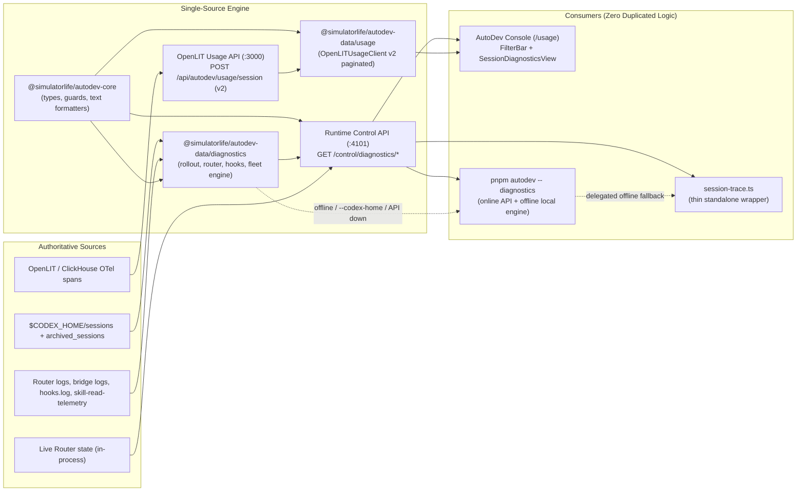

# Unified Session Diagnostics & Session-Scoped Console Usage

## Goal Description

Today AutoDev has two disconnected ways to inspect a session:

1. **The `autodev-session-diagnostics` skill** ([`session-trace.ts`](../.rulesync/skills/autodev-session-diagnostics/scripts/session-trace.ts), ~3,493 lines) parses Codex active and archived rollouts, rotated router logs, bridge logs, `hooks.log`, `skill-read-telemetry`, and live router state to produce rich per-session and fleet diagnostics (turns, 60s+ gaps, token/cache/reasoning efficiency, >50% cache drops, compaction payload sizes & image counts, initial developer-prompt & skill root overhead, categorized tool failures, pre-edit investigation metrics, router skips/retries/exhaustion waits, provider hops, bridge alerts, and deployment drift).
2. **The Console Usage page (`/usage`)** has a separate mid-page **Session activity** client island ([`SessionUsageLookup.ts`](../console/src/features/usage/SessionUsageLookup.ts)) with its own **Inspect session** button that sends a `POST /api/usage/session` request to OpenLIT `POST /api/autodev/usage/session`, returning at most **200** OTel span summaries with no pagination and none of the rollout/router/efficiency diagnostics above.

This plan unifies both surfaces onto **one single-source diagnostics architecture**:

- Extracts the diagnostics engine into `@simulatorlife/autodev-data/diagnostics` with typed contracts and text formatters in `@simulatorlife/autodev-core`.
- Exposes authenticated, read-only **`GET /control/diagnostics/*`** endpoints on the AutoDev Control API (`:4101`), bumping `CONTROL_API_CONTRACT.version` from `34` to `35`.
- Turns [`.rulesync/skills/autodev-session-diagnostics/scripts/session-trace.ts`](../.rulesync/skills/autodev-session-diagnostics/scripts/session-trace.ts) into a thin (~250-line), standalone wrapper that calls the same Control API endpoint (falling back to the same single-source engine via [`runtime/src/cli/autodev.ts`](../runtime/src/cli/autodev.ts) `diagnostics` for `--offline`, `--codex-home`, `--router-log`, or when the Control API is unreachable).
- Moves the **Session ID** input directly into the top [`FilterBar`](../console/src/components/filters/FilterBar.ts) on `/usage`, deletes the separate **Session activity** form and **Inspect session** button, and makes setting a Session ID + clicking **Apply filters** scope the **entire** `/usage` view to that session's unified diagnostics (`Overview`, `Threads & Turns`, `Failures & Hooks`, `Router Requests`, and paginated `OTel Spans`) plus unscoped `Recent sessions` and `Hook denials` views.
- Upgrades OpenLIT's `POST /api/autodev/usage/session` endpoint (`patches/openlit/79-autodev-usage-session-pagination.patch`, schema `autodev-openlit-session-usage-v2`) to support `limit`, `offset`, `sortDirection`, exact `total`, `hasMore`, and full-session `estimatedCostUsd`, removing the 200-span cap via server-rendered [`Pagination`](../console/src/components/navigation/Pagination.ts).



---

## User Review Required

> [!IMPORTANT]
> **1. URL-addressable `?sessionId=...` in the top `FilterBar` ([`autodev-console-target-state.md`](autodev-console-target-state.md) update)**
> Previously, [`autodev-console-target-state.md`](autodev-console-target-state.md) required keeping Session IDs out of the URL, which forced [`SessionUsageLookup.ts`](../console/src/features/usage/SessionUsageLookup.ts) into a separate client-side `POST` panel with an **Inspect session** button.
> Moving `Session ID` into the top [`FilterBar`](../console/src/components/filters/FilterBar.ts) (`GET /usage?range=...&sessionId=...`) submitted by **Apply filters** enables 100% server-rendered tabs and pagination, in-place Next.js navigation, browser Back/Forward history, and 1-click drilldown links from **Active sessions** and **Recent sessions** — matching `/playtesting/sessions/[id]` and `/usage?spanId=...` on this single-user local Console.
> Session IDs will **remain strictly excluded** from OpenTelemetry metric dimensions and `USAGE_VARIABLE_IDS` filter dropdowns, will always be validated with [`safeAutoDevSessionId`](../core/src/usage/session-id.ts), and responses will omit raw prompt bodies and credentials. [`autodev-console-target-state.md`](autodev-console-target-state.md) and [`console/e2e/usage-session-acceptance.spec.ts`](../console/e2e/usage-session-acceptance.spec.ts) will be updated in the same change.

> [!IMPORTANT]
> **2. Single-Source API Host (`:4101/control/diagnostics/*`) & Offline Skill Fallback**
> The shared diagnostics HTTP API will live on the authenticated **AutoDev Control API** (`http://127.0.0.1:4101/control/diagnostics/*`, bumping `CONTROL_API_CONTRACT.version` from `34` to `35`), keeping diagnostics available whenever Runtime is running (even if Console is stopped) and giving direct in-process access to live router status/MCP exposure/cooldowns without a self-HTTP call.
> - In default online use, [`session-trace.ts`](../.rulesync/skills/autodev-session-diagnostics/scripts/session-trace.ts) calls `GET $CONTROL_API_BASE_URL/control/diagnostics/*` using the local Control API token (read in-process from env or `$CODEX_HOME/openlit-secrets.env`, never printed or logged), matching [`runtime/src/hooks/memory-session-end.ts`](../runtime/src/hooks/memory-session-end.ts).
> - When invoked with `--offline`, `--codex-home <dir>`, or `--router-log <file>` — or when the Control API service is down — `session-trace.ts` delegates to `node <repo>/runtime/src/cli/autodev.ts diagnostics ...`, which runs the **same `@simulatorlife/autodev-data/diagnostics` engine** directly on disk without duplicating parsing logic in the standalone skill script (preserving ESLint's `allowOnly("skill-script", [])` rule in [`eslint.config.js`](../eslint.config.js)).

> [!WARNING]
> **3. Clean Schema Cutover (`autodev-openlit-session-usage-v2`) & Deployment Note**
> Per [`AGENTS.md`](../AGENTS.md), no legacy `v1` compatibility shims will be kept: OpenLIT patch `79-autodev-usage-session-pagination.patch`, [`OpenLITUsageClient`](../data/src/usage/openlit-usage-client.ts), and the Console will cut over atomically to `autodev-openlit-session-usage-v2` (`limit`, `offset`, `sortDirection`, exact `total`, `hasMore`, `estimatedCostUsd`).
> Live deployment of the paginated OpenLIT endpoint, Control API routes, and Console UI requires rebuilding/restarting those services only after explicit user authorization; implementation work must **not** run `scripts/install.sh` or restart launchd/Docker services without permission.

---

## Proposed Changes

Changes are ordered bottom-up along the monorepo dependency graph: **Core → Data → Runtime (Control API + CLI) → OpenLIT Patch → Console UI → Skill & Docs**.

---

### 1. Core Contracts & Pure Text Formatters (`core/`)

#### `[NEW]` `core/src/diagnostics/types.ts`

Pure domain types, schema identifiers, pagination bounds, and runtime validators (zero Node I/O):

- **Schemas:**
  - `SESSION_DIAGNOSTICS_SCHEMA = "autodev-session-diagnostics-v1"`
  - `SESSION_RECENT_LIST_SCHEMA = "autodev-session-recent-v1"`
  - `SESSION_FLEET_SCAN_SCHEMA = "autodev-session-fleet-scan-v1"`
  - `SESSION_HOOK_DENIALS_SCHEMA = "autodev-session-hook-denials-v1"`
- **Canonical types unified from `session-trace.ts`:**
  - `ToolFailureCategory`, `SessionToolFailure`, `SessionThreadAnomalies`, `SessionThreadTokenUsage`, `SessionThreadCompactionSummary`, `SessionThreadPromptOverhead`, `SessionThreadEfficiency`, `SessionThreadTurn`, `SessionThreadGap`, `SessionThreadItem`, `SessionInvestigation`, `SessionThreadTrace`
  - `SessionRouterEventRow`, `SessionRouterSkippedEvent`, `SessionRouterFailure`, `SessionRouterProviderStats`, `SessionRouterSummary`
  - `SessionBridgeLogAlert`, `SessionLogFileSummary`, `SessionLiveReport`, `SessionEfficiencyWorkspaceMcpSummary`, `SessionEfficiencySummary`
  - `SessionPagedSlice<T>`: `{ items, total, limit, offset, hasMore }`
  - `SessionDiagnosticsAggregates`: pre-computed session-wide rollups across all threads (`threadCount`, `totalTokens`, `inputTokens`, `cachedInputTokens`, `outputTokens`, `reasoningOutputTokens`, `cacheHitPct`, `reasoningPct`, `peakInputTokens`, `cacheDrops`, `compactions`, `contextCompactedEvents`, `maxReplacementItems`, `maxReplacementBytes`, `maxReplacementImages`, `responseImageItems`, `maxInitialDeveloperBytes`, `maxInitialDeveloperChars`, `maxInitialDeveloperTokens`, `maxSkillsCatalogBytes`, `maxSkillsLoaded`, `skillsByRoot`, `uniqueSkillsRead`, `skillReadCounts`, `skillTelemetryReads`, `turnsTotal`, `turnsByOutcome`, `gapsCount`, `toolCallsTotal`, `toolCallsByName`, `toolFailuresTotal`, `toolFailuresByCategory`, `preToolUseBlocks`, `routerRequests`, `routerFailures`, `routerSkippedTotal`, `routerSkippedByReason`, `routerRetries`, `exhaustionWaits`, `transportErrors`, `providerHops`, `byProvider`)
  - Each thread's `efficiency.prompt` measures the initial developer prompt (every developer message before the thread's first agent output) as UTF-8 `initialDeveloperBytes` and Unicode code-point `initialDeveloperChars` (a surrogate pair or an unpaired surrogate counts once; not graphemes). `initialDeveloperTokens` is `null` because rollouts record token usage per request, not per message, and no provider tokenizer is available; the engine never estimates it. `skillReadCounts` is keyed by exactly the names in `skillsRead` and counts the tool calls that read each SKILL.md (one per call, however often the call names it). The aggregates take prompt maxima across threads, sum `skillReadCounts`, and set `uniqueSkillsRead` to its key count; `maxInitialDeveloperTokens` stays `null` until some thread reports a token count.
  - `SessionDiagnosticsReport` (preserves top-level `threads` array with `investigation.observed` so [`investigation-compare.ts`](../.rulesync/skills/autodev-session-diagnostics/scripts/investigation-compare.ts) continues to accept `--json` output directly)
  - `RecentSessionSummary`, `SessionRecentListResponse`, `FleetSessionRow`, `FleetScanTotals`, `SessionFleetScanResponse`, `HookDenialSummary`, `SessionHookDenialsResponse`
- **Runtime validators:** `isSessionDiagnosticsReport`, `isSessionRecentListResponse`, `isSessionFleetScanResponse`, `isSessionHookDenialsResponse` used by the Console's Control API client so malformed payloads fail closed.

#### `[NEW]` `core/src/diagnostics/format.ts`

Pure, deterministic CLI text formatters extracted from [`session-trace.ts`](../.rulesync/skills/autodev-session-diagnostics/scripts/session-trace.ts) (`renderSessionDiagnosticsReport`, `renderRecentSessions`, `renderFleetScanReport`, `renderHookDenialsReport`), supporting `failures`, `allFailures`, `efficiency`, `items`, and `events` display flags. Shared by the Control API `?format=text` response and the offline CLI so text rendering never drifts.

#### `[NEW]` `core/src/diagnostics/index.ts`

Barrel re-exporting `types.ts` and `format.ts`.

#### `[MODIFY]` [`core/src/usage/types.ts`](../core/src/usage/types.ts)

Update `UsageSessionEvidence` and add `UsageSessionSpanPagination`:

```ts
export type UsageSessionSpanSortDirection = "desc" | "asc";

export interface UsageSessionSpanPagination {
  readonly limit: number;
  readonly offset: number;
  readonly sortDirection?: UsageSessionSpanSortDirection;
}

export interface UsageSessionEvidence {
  readonly total: number | null;
  readonly limit: number;
  readonly offset: number;
  readonly hasMore: boolean;
  readonly partial: boolean;
  readonly estimatedCostUsd: number | null;
  readonly spans: readonly UsageSessionSpanSummary[];
}
```

Keep `USAGE_VARIABLE_IDS` unchanged (`workspace`, `provider`, `model`, `agent`, `skill` — `sessionId` never becomes a metric dimension).

#### `[MODIFY]` [`core/src/control-api/contract.ts`](../core/src/control-api/contract.ts)

Increment `CONTROL_API_CONTRACT.version` from `34` to `35` and document `v35` (`/control/diagnostics/*` read-only session diagnostics, recent sessions, fleet scan, and hook-denial summary endpoints).

#### `[MODIFY]` [`core/src/index.ts`](../core/src/index.ts)

Export `./diagnostics/index.ts`.

---

### 2. Single-Source Diagnostics Engine & Paginated Usage Client (`data/`)

#### `[NEW]` `data/src/diagnostics/rollout-discovery.ts`

Authoritative rollout discovery across `$CODEX_HOME/sessions/` and `$CODEX_HOME/archived_sessions/` (`rolloutRoots`, `findSessionRollouts`, `listRecentSessions`, `readHeadMeta`). Resolves either a root session ID or a child thread ID to the entire session tree. Validates IDs via [`safeAutoDevSessionId`](../core/src/usage/session-id.ts) before any path lookup.

#### `[NEW]` `data/src/diagnostics/thread-tracer.ts`

Authoritative per-thread rollout analyzer (`traceThread`):

- Extracts `session_meta`, `turn_context`, turns, 60s+ gaps, tool counts (including MCP calls parsed from `exec` code mode), categorized `ToolFailure`s (with secret-redacted `detail` and `input` excerpts), `ThreadAnomalies`, `Investigation` pre-edit metrics (`ccc`/`cgc`/`lsp`, reads, searches), `ThreadEfficiency` (cumulative tokens across resets, cache-hit %, reasoning %, peak input, >50% cache drops, compaction payload items/bytes/structured images, response images, initial developer prompt bytes, `<skills_instructions>` root breakdown, `SKILL.md` reads, `$CODEX_HOME/run/skill-read-telemetry` SHA-256 hash counts), and optional rollout items.
- Redacts bearer tokens, API key prefixes, and sensitive env/flag assignments from failure excerpts before returning.

#### `[NEW]` `data/src/diagnostics/router-events.ts`

Authoritative router log reader (`routerLogFiles`, `readRouterEvents`, `summarizeRouter`) spanning live `codex-model-router.launchd.err.log` and rotated `.err.log.1..N`: per-provider requests/failures/elapsedMs/toolCalls, provider hop sequence, `ROUTER SKIPPED`, `retries`, `exhaustionWaits`, `transportErrors`, and optional raw event rows.

#### `[NEW]` `data/src/diagnostics/hook-denials.ts`

Authoritative `$CODEX_HOME/hooks/hooks.log` parser (`summarizeHookDenials`) aggregating `PreToolUse` denials by policy, role, reason, and top sanitized command heads within a bounded `sinceDays` window.

#### `[NEW]` `data/src/diagnostics/fleet-scan.ts`

Authoritative cross-session efficiency & failure/skip fleet scanner (`scanRecentSessions`) using a single pass over rotated router logs + N recent sessions.

#### `[NEW]` `data/src/diagnostics/live-context.ts`

Live runtime context helpers (`collectLiveDiagnostics`, `readBridgeLogAlerts`, `readLogSummaries`, `buildEfficiencySummary`, `hasOpenTurn`, `deploymentDrift`). Accepts an optional in-process `routerStatus` provider (used by the Runtime Control API to avoid loopback self-HTTP calls) and falls back to `GET http://127.0.0.1:4100/status` when invoked from CLI online mode.

#### `[NEW]` `data/src/diagnostics/session-report.ts`

Composes `buildSessionDiagnosticsReport` (resolves session tree, runs `traceThread` + `readRouterEvents` + `summarizeRouter`, computes `SessionDiagnosticsAggregates`, attaches `bridgeAlerts`, `logs`, `efficiency`, `live`, and slices paginated `eventsPage` / `itemsPage` when requested).

#### `[NEW]` `data/src/diagnostics/index.ts`

Public barrel for `@simulatorlife/autodev-data/diagnostics`.

#### `[MODIFY]` [`data/package.json`](../data/package.json) & [`data/src/index.ts`](../data/src/index.ts)

Add `"./diagnostics": "./src/diagnostics/index.ts"` export and re-export from `data/src/index.ts`.

#### `[MODIFY]` [`data/src/usage/openlit-usage-client.ts`](../data/src/usage/openlit-usage-client.ts)

Upgrade `SESSION_USAGE_SCHEMA` to `"autodev-openlit-session-usage-v2"` and `querySession(sessionId, selection, pagination?, options?)`:

- Sends `{ sessionId, range, customRange?, limit, offset, sortDirection }` (clamped: `limit` in `1..200`, default `50`; `offset` in `0..100_000`, default `0`; `sortDirection` `"desc" | "asc"`).
- Validates and parses `total` (`safeInteger >= 0 | null`), `limit`, `offset`, `hasMore`, `partial`, `estimatedCostUsd` (`finite >= 0 | null`), and `spans` (up to `MAX_SESSION_SPANS = 200` per page).

---

### 3. Control API Diagnostics Endpoints & CLI (`runtime/`)

#### `[NEW]` `runtime/src/control-api/diagnostics.ts`

Authenticated, read-only (`GET` only; HTTP 405 with `Allow: GET` on non-GET) Control API handler mounted under `/control/diagnostics`:

- `GET /control/diagnostics/sessions/recent?limit=N[&format=json|text]`
- `GET /control/diagnostics/sessions/scan?limit=N[&format=json|text]`
- `GET /control/diagnostics/hooks?sinceDays=D[&format=json|text]`
- `GET /control/diagnostics/sessions/:id` with bounded allowlisted query parameters:
  - `format=json|text` (default `json`; `text` sets `Content-Type: text/plain; charset=utf-8` and `X-Content-Type-Options: nosniff`)
  - `offline=0|1`, `includeEfficiency=0|1` (default `1`), `includeFailures=0|1`, `allFailures=0|1`
  - `includeEvents=0|1`, `eventsLimit` (`1..200`, default `50`), `eventsOffset` (`>= 0`, default `0`)
  - `includeItems=0|1`, `itemsLimit` (`1..200`, default `50`), `itemsOffset` (`>= 0`, default `0`)
  - `threadId` (optional `safeAutoDevSessionId` filter for narrowing items/events to one thread)
- Returns HTTP `200` with `found: true | false` for valid IDs (distinguishing absent local rollouts from Control API outages); rejects invalid `:id` or query params with HTTP `400` without echoing untrusted input.
- Reads live router status through a registered in-process provider callback (`setControlApiDiagnosticsRouterStatusSource`), avoiding loopback HTTP self-calls.
- Allows both `viewer` and `operator` Control API roles (read-only).

#### `[MODIFY]` [`runtime/src/control-api/request-handler.ts`](../runtime/src/control-api/request-handler.ts), [`runtime/src/router/http.ts`](../runtime/src/router/http.ts), & [`runtime/src/router/server.ts`](../runtime/src/router/server.ts)

- Add `diagnostics: "/control/diagnostics"` to `CONTROL_API_PATHS` and dispatch `/control/diagnostics/*` in `handleControlApiRequest`.
- Wire live in-process router status callback from `runtime/src/router/http.ts` / `server.ts` into `setControlApiDiagnosticsRouterStatusSource`.

#### `[NEW]` `runtime/src/cli/diagnostics.ts`, `[MODIFY]` [`runtime/src/cli/autodev.ts`](../runtime/src/cli/autodev.ts), & `[MODIFY]` [`eslint.config.js`](../eslint.config.js)

Add `pnpm autodev -- diagnostics` CLI subcommand supporting all flags (`<id>`, `--recent [N]`, `--scan-recent [N]`, `--hooks [--since D]`, `--failures`, `--all-failures`, `--efficiency`, `--items`, `--events`, `--json`, `--offline`, `--codex-home DIR`, `--router-log FILE`):

- Calls `GET $CONTROL_API_BASE_URL/control/diagnostics/*` by default when online with no custom `--codex-home`/`--router-log` override.
- Runs `@simulatorlife/autodev-data/diagnostics` + `@simulatorlife/autodev-core` formatters directly in-process when `--offline`, `--codex-home`, or `--router-log` is passed, or when the Control API is unreachable.
- Allow `"data"` in `allowOnly("runtime-cli", ...)` in [`eslint.config.js`](../eslint.config.js) (matching `runtime-config` and `runtime-platform`).

#### `[MODIFY]` [`runtime/src/platform/install-materializer.ts`](../runtime/src/platform/install-materializer.ts), [`runtime/package.json`](../runtime/package.json), & [`tests/platform/runtime-manifest.test.ts`](../tests/platform/runtime-manifest.test.ts)

Register `runtime/src/control-api/diagnostics.ts` and `runtime/src/cli/diagnostics.ts` in `RUNTIME_MODULES`, `runtime/package.json` `exports`, and `tests/platform/runtime-manifest.test.ts`.

---

### 4. OpenLIT Paginated Session Spans (`patches/openlit/`)

#### `[NEW]` `patches/openlit/79-autodev-usage-session-pagination.patch`

Patches `src/client/src/app/api/autodev/usage/session/route.ts` and `src/client/src/__tests__/app/api/autodev/usage/session/route.test.ts`:

- Cuts over schema cleanly to `autodev-openlit-session-usage-v2`.
- Accepts optional validated `limit` (`1..200`, default `50`), `offset` (`0..100_000`, default `0`), and `sortDirection` (`"desc" | "asc"`, default `"desc"`).
- Runs bounded queries through `runUsageQuery`:
  1. `adapter.aggregateSpans` for exact matching span `total` (`count()`) and full-session `estimatedCostUsd` (`sum(gen_ai.usage.cost)` when observed) over the exact `service.name = "autodev-router"` + `autodev.session.id = sessionId` filters and time range.
  2. `adapter.listSpans` with `limit: pageLimit + 1`, `offset`, and `sort: [{ field: "Timestamp", direction: sortDirection }]` to slice the requested page (`<= 200` spans) and determine `hasMore = rawRows.length > pageLimit || (total !== null && offset + spans.length < total)`.
- Sets `partial: true` only when source truncation or malformed-row omission actually occurs (never merely because `total > 200`).
- Preserves strict redaction (never echoes `sessionId`, raw span attributes, events, prompts, or tool arguments).

#### `[MODIFY]` [`tests/openlit-patches-apply.test.ts`](../tests/openlit-patches-apply.test.ts)

Update patch-application assertions for patch `79` and `autodev-openlit-session-usage-v2` pagination behavior.

---

### 5. Unified Console `/usage` UI (`console/`)

#### `[DELETE]` [`console/src/features/usage/SessionUsageLookup.ts`](../console/src/features/usage/SessionUsageLookup.ts)
#### `[DELETE]` [`console/app/api/usage/session/route.ts`](../console/app/api/usage/session/route.ts)
#### `[DELETE]` [`console/tests/usage-session-route.test.ts`](../console/tests/usage-session-route.test.ts)

Remove the superseded client-only POST lookup island, its browser proxy route, and its `approvedClientModules` entry in [`console/tests/console.test.ts`](../console/tests/console.test.ts). Everything moves to server-rendered, URL-addressable `UsagePage` + `FilterBar` + `SessionDiagnosticsView`.

#### `[MODIFY]` [`console/src/lib/server/control-api.ts`](../console/src/lib/server/control-api.ts)

Add `diagnostics: "/control/diagnostics"` to `CONTROL_API_PATHS` and typed server-side fetchers (`20_000ms` timeout, Core schema validation):

- `fetchSessionDiagnostics(sessionId, options, config, fetchOptions)`
- `fetchRecentSessions(limit, config, fetchOptions)`
- `fetchFleetSessionScan(limit, config, fetchOptions)`
- `fetchHookDenials(sinceDays, config, fetchOptions)`

#### `[MODIFY]` [`console/src/lib/server/openlit-usage.ts`](../console/src/lib/server/openlit-usage.ts)

- Update `loadOpenLITSessionUsage(sessionId, selection, pagination, env)` to pass `{ limit, offset, sortDirection }`.
- Add `usageViewStateFromSearchParams(searchParams, now)` returning:
  - `selection` (existing `UsageFilterSelection`)
  - `rawSessionId` (trimmed string or `""`) and `sessionId` (`safeAutoDevSessionId(rawSessionId)`)
  - `view`: `"overview" | "sessions" | "hooks"` (unscoped Usage tabs)
  - `tab`: `"overview" | "threads" | "failures" | "requests" | "spans"` (session-scoped tabs)
  - `spanOffset`, `spanLimit` (`50 | 100 | 200`, default `50`), `spanSort` (`"desc" | "asc"`)
  - `eventsOffset`, `eventsLimit` (`50 | 100`, default `50`)
  - `itemsOffset`, `itemsLimit` (`50 | 100`, default `50`)
  - `threadId` (`safeAutoDevSessionId` or `undefined`), `failureCategory` (allowlisted `ToolFailureCategory` or `undefined`)
  - `hooksSinceDays` (`1 | 7 | 30`, default `7`)

#### `[NEW]` `console/src/features/usage/SessionDiagnosticsView.ts`

Pure server-rendered React component using only shared dark theme tokens and primitives from `console/src/components/` (`StatGrid`, `StatCard`, `BarChart`, `DataTable`, `TabNav`, `Pagination`, `DetailGrid`, `Callout`, `Tag`, `NavigationLink`) — zero `"use client"`, zero hooks, verified by [`console/tests/style-vocabulary.test.ts`](../console/tests/style-vocabulary.test.ts):

- **Session Context Header & Alert Strip:** Resolved root session ID (noting when matched via child thread ID), workspace (`cwd`), start/end timestamps + duration, CLI version, live/open-turn status badge, **Clear session** link, and warning callouts for bridge alerts, deployment drift, or `found: false`.
- **`TabNav` (preserving `sessionId` and `range` in URL):**
  - **`Overview`**:
    - Session KPI `StatGrid`s (Total Tokens & Reasoning %, Cache-Read Rate / Cache Drops / Peak Input, Router Requests / Failures / Skipped / Retries, Estimated Cost from OpenLIT spans, Turns & 60s+ Gaps, Context Compactions & Replacement Size/Images, Prompt & Skill Overhead, Tool Calls / Failures / `PreToolUse` Hook Blocks).
    - Breakdown `BarChart`s (Requests by Provider, Tokens by Thread/Role, Top Tool Calls, Tool Failures by Category, Router Skipped by Reason when present).
    - Thread Tree `DataTable` (Root + subagents with Role, Model, Providers/Hops, Turns, Tokens, Cache %, Compactions, Skills Loaded/Read, Failures, Investigation pre-edit summary, clickable jump to `Threads & Turns`).
  - **`Threads & Turns`**:
    - Thread filter links (`All threads` or single thread), per-thread `DetailGrid` (prompt bytes, skill roots, read `SKILL.md` tags, `skill-read-telemetry` count, investigation counts), Turns `DataTable`, 60s+ Gaps `DataTable`, and (when a thread is selected) paginated Rollout Items `DataTable` + [`Pagination`](../console/src/components/navigation/Pagination.ts).
  - **`Failures & Hooks`**:
    - Failure category filter chips/links + Categorized Tool Failures `DataTable` (Time, Thread/Role, Tool, Category `Tag`, Detail, Sanitized Input Preview) + Router Failures, Router Skipped Events, Retries/Exhaustion Waits, and Bridge Log Alerts.
  - **`Router Requests`**:
    - Per-thread Router Summary `DataTable` (Match mode, Requests, Provider sequence/hops, Failures, Skipped, Retries, Exhaustion waits, Transport errors) + paginated Router Events `DataTable` + `Pagination`.
  - **`OTel Spans`**:
    - Page size (`50` / `100` / `200`) and sort order (`Newest first` / `Oldest first`) controls + `DataTable` of `UsageSessionSpanSummary` (each `spanId` links to the existing Trace Detail panel while preserving `sessionId`, `tab=spans`, and `spanOffset`) + shared [`Pagination`](../console/src/components/navigation/Pagination.ts) component navigating across all spans (e.g. `1–50 of 438`, `51–100 of 438`, …) without a 200-span wall.
- **Unscoped Fleet Diagnostics sub-views** (exported alongside or in a sibling `UsageFleetDiagnosticsView.ts`):
  - **`Recent sessions` tab (`view=sessions`):** renders `SessionFleetScanResponse` (`--scan-recent`) KPIs + `DataTable` with 1-click links into `/usage?range=<range>&sessionId=<id>`.
  - **`Hook denials` tab (`view=hooks`):** renders `SessionHookDenialsResponse` (`--hooks`) window selector (`1d` / `7d` / `30d`), `StatGrid`, policy/role `BarChart`s, reasons & top blocked commands `DataTable`s.

#### `[MODIFY]` [`console/src/features/usage/UsageView.ts`](../console/src/features/usage/UsageView.ts) & [`console/app/usage/page.ts`](../console/app/usage/page.ts)

- Move the `Session ID` input (`id="usage-session-id"`, `name="sessionId"`, `placeholder="Session or thread ID"`, `maxLength={128}`) directly into the top [`FilterBar`](../console/src/components/filters/FilterBar.ts) on `/usage` (historical scopes; Active Sessions keeps its auto-submit scope selector and links every identified live session row directly to `/usage?range=24H&sessionId=<id>`).
- Remove `SessionUsageLookup` rendering completely; there is **no** separate panel and **no** separate "Inspect session" button — clicking **Apply filters** applies `Session ID` alongside scope/filters.
- When `rawSessionId` is non-empty:
  - `page.ts` skips the fleet-wide `readUsageTelemetry(selection)` query completely.
  - Invalid `sessionId` renders a warning callout and zero fleet metrics.
  - Valid `sessionId` fetches `fetchSessionDiagnostics(...)` + `loadOpenLITSessionUsage(...)` (paginated) + optional `loadOpenLITTrace(...)` in parallel and renders `SessionDiagnosticsView` for the entire page body (with independent degradation notices if either Control API or OpenLIT is unavailable).
  - The top `FilterBar` displays a `Clear session` link and hides fleet-only multi-selects (noting if any leftover fleet filters were present in the URL so nothing is silently dropped).
- When `rawSessionId` is empty and historical scope is active:
  - Renders an unscoped `TabNav` (`Aggregate usage` | `Recent sessions` | `Hook denials`) above the historical body, keeping `Aggregate usage` as the default so all existing `/usage` links and acceptance specs behave identically.

---

### 6. Thin Standalone Skill Wrapper & Documentation (`.rulesync/`, `docs/`)

#### `[MODIFY]` [`.rulesync/skills/autodev-session-diagnostics/scripts/session-trace.ts`](../.rulesync/skills/autodev-session-diagnostics/scripts/session-trace.ts)

Collapse from ~3,493 lines to a thin (~250-line) standalone Node-built-ins-only wrapper:

- Preserves **100%** of existing CLI flags and stdout contract (`<id>`, `--recent [N]`, `--scan-recent [N]`, `--hooks [--since D]`, `--failures`, `--all-failures`, `--efficiency`, `--items`, `--events`, `--json`, `--offline`, `--codex-home DIR`, `--router-log FILE`, plus `--control-api-url URL`).
- Default online mode: calls `GET $CONTROL_API_BASE_URL/control/diagnostics/...` with `Authorization: Bearer <token>` (read from env or `$CODEX_HOME/openlit-secrets.env`, never printed) and `X-AutoDev-Actor: autodev-local`, requesting `?format=json` (`--json`) or `?format=text` (default).
- Offline / custom-path / Control-API-unreachable fallback: locates the AutoDev checkout and runs `node <repo>/runtime/src/cli/autodev.ts diagnostics ...`, using the **exact same single-source engine** with zero duplicated parsing logic.

#### `[MODIFY]` [`.rulesync/skills/autodev-session-diagnostics/SKILL.md`](../.rulesync/skills/autodev-session-diagnostics/SKILL.md) & [`.rulesync/commands/autodev-usage-efficiency.md`](../.rulesync/commands/autodev-usage-efficiency.md)

Document the unified `/control/diagnostics/*` API, the `pnpm autodev -- diagnostics` CLI entrypoint, and the Console `/usage?sessionId=<id>` UI view. Regenerate gitignored `.agents/` / `.claude/` / `.github/` projections via `pnpm exec rulesync generate --config rulesync.jsonc --features skills,commands --silent`.

#### `[MODIFY]` [`docs/autodev-console-target-state.md`](autodev-console-target-state.md) & [`docs/autodev-console-migration.md`](autodev-console-migration.md)

Update the Usage dashboard and Control API sections in place to document:

- Unified read-only `/control/diagnostics/*` endpoints (Control API contract v35).
- Session ID as a top-bar view scope filter on `/usage` (URL-addressable `?sessionId=...`, still excluded from OTel metric dimensions and `USAGE_VARIABLE_IDS`).
- Paginated `POST /api/autodev/usage/session` (`autodev-openlit-session-usage-v2`) replacing the fixed 200-span cap.
- Keep all required Active Sessions / Usage invariants verified by [`tests/autodev-console-target-state.test.ts`](../tests/autodev-console-target-state.test.ts) intact.

## 7. Additional/Misc. Metrics/Data to Show/Include

1. Skill usage (what skills were used, how many times, and which threads used them).
2. For the "Threads" list, it should include the model provider that was used. As well as showing the "role" model (e.g. "autodev/orchestrator"), the "threads" list/table should also show the model provider model used for that thread (e.g. "gpt-4o", "claude-v1.3", etc.). This is important for debugging and understanding the behavior of the session.
3. The "Initial developer prompt" should be shown with a dotted-underline and be clickable. Clicking on it should toggle between 3 units: (1) bytes, (2) characters, (3) tokens (should use our shared/common component "Inline display toggle").

---

## Verification Plan

### Automated Tests

1. **Typecheck across all workspaces:**

   ```bash
   pnpm run typecheck
   ```

2. **Lint & formatting (strict `--max-warnings=0`, ESLint boundary rules including `skill-script`):**

   ```bash
   pnpm run lint
   pnpm run format:check
   ```

3. **Core, Data, Runtime, and Root unit tests:**
   - New tests in `core/tests/diagnostics.test.ts` (validators + text formatters).
   - New/migrated tests in `data/tests/diagnostics/*.test.ts` (rollout discovery across active+archived, `traceThread` efficiency/compaction/cache-drops/skills/failures, rotated router logs + skips/retries/hops, hook denials, fleet scan, secret redaction).
   - Updated [`data/tests/usage/openlit-usage-client.test.ts`](../data/tests/usage/openlit-usage-client.test.ts) (`v2` paginated `querySession`, `limit`/`offset`/`total`/`hasMore`/`estimatedCostUsd`, fail-closed validation).
   - New tests in `runtime/tests/control-api-diagnostics.test.ts` (auth, `405` on `POST`, `400` on invalid `sessionId`/query params, JSON + `format=text`, paginated events/items, live router status injection, `found: false` vs `found: true`).
   - Updated [`tests/session-diagnostics-skill.test.ts`](../tests/session-diagnostics-skill.test.ts) (thin wrapper HTTP call against fake Control API server + offline/`--codex-home` CLI fallback + `investigation-compare.ts` compatibility).
   - Updated [`tests/openlit-patches-apply.test.ts`](../tests/openlit-patches-apply.test.ts), [`tests/platform/runtime-manifest.test.ts`](../tests/platform/runtime-manifest.test.ts), [`tests/cli/command-usage.test.ts`](../tests/cli/command-usage.test.ts), [`tests/cli/dev.test.ts`](../tests/cli/dev.test.ts), [`tests/autodev-console-target-state.test.ts`](../tests/autodev-console-target-state.test.ts), and [`tests/rulesync-skills.test.ts`](../tests/rulesync-skills.test.ts).

   ```bash
   pnpm --filter @simulatorlife/autodev-core test
   pnpm --filter @simulatorlife/autodev-data test
   pnpm --filter @simulatorlife/autodev-runtime test
   node --import ./runtime/tests/support/isolate-codex-state.ts --test \
     tests/session-diagnostics-skill.test.ts \
     tests/openlit-patches-apply.test.ts \
     tests/platform/runtime-manifest.test.ts \
     tests/cli/command-usage.test.ts \
     tests/cli/dev.test.ts \
     tests/autodev-console-target-state.test.ts \
     tests/rulesync-skills.test.ts
   ```

4. **Console unit, style-vocabulary, and Playwright browser acceptance tests:**
   - Update [`console/tests/usage-page.test.ts`](../console/tests/usage-page.test.ts) and [`console/tests/console.test.ts`](../console/tests/console.test.ts) (client-module registry, top-bar `sessionId` input, session-scoped rendering, pagination links, unscoped `Recent sessions` & `Hook denials` tabs).
   - Run [`console/tests/style-vocabulary.test.ts`](../console/tests/style-vocabulary.test.ts) (verifies every Tailwind utility resolves to a dark theme token with zero palette literals or conflicts).
   - Update [`console/e2e/openlit-usage-fixture.ts`](../console/e2e/openlit-usage-fixture.ts) (serve paginated `v2` session spans with >200 spans, e.g. 250 spans) and [`console/e2e/playtesting-control-api-fixture.ts`](../console/e2e/playtesting-control-api-fixture.ts) (serve `/control/diagnostics/*` fixtures).
   - Update [`console/e2e/usage-session-acceptance.spec.ts`](../console/e2e/usage-session-acceptance.spec.ts) to test end-to-end in Chromium:
     - Entering a Session ID in the top `FilterBar` and clicking **Apply filters** scopes the entire `/usage` page to that session (no separate **Inspect session** button, no fleet metrics rendered).
     - Switching tabs (`Overview`, `Threads & Turns`, `Failures & Hooks`, `Router Requests`, `OTel Spans`) preserves `sessionId` and renders diagnostics accurately.
     - Paginating past span 200 (e.g., Page 1 → Page 5 of 250 spans) via `Pagination` works cleanly without the 200-span cap warning.
     - Invalid Session ID fails closed; clearing Session ID returns to fleet Usage; `Recent sessions` and `Hook denials` tabs work and link into session diagnostics.
   - Verify [`console/e2e/usage-dashboard-acceptance.spec.ts`](../console/e2e/usage-dashboard-acceptance.spec.ts) still passes untouched.

   ```bash
   pnpm --filter @simulatorlife/autodev-console test
   pnpm --filter @simulatorlife/autodev-console exec playwright test \
     e2e/usage-session-acceptance.spec.ts \
     e2e/usage-dashboard-acceptance.spec.ts
   ```

### Manual Verification

1. **CLI & skill wrapper parity check (read-only against a real local session such as `01a1f0f4-7de2-7cb3-840f-cfe303f304c0`):**
   - Run `node .agents/skills/autodev-session-diagnostics/scripts/session-trace.ts 01a1f0f4-7de2-7cb3-840f-cfe303f304c0 --efficiency --failures --offline` and confirm output matches the pre-refactor report schema and compact byte budget.
   - Once rebuilding/restarting Runtime, OpenLIT, and Console is explicitly authorized:
     - Run `session-trace.ts` **without** `--offline` and verify it reads cleanly from `http://127.0.0.1:4101/control/diagnostics/...`.
     - Open `/usage` in the Console, click a session from **Recent sessions** (or paste a session ID into the top **Session ID** field and click **Apply filters**), inspect all 5 tabs (`Overview`, `Threads & Turns`, `Failures & Hooks`, `Router Requests`, `OTel Spans`), and page past span 200 on a long session.

## Documentation Updates

This file itself (`docs/unified-session-diagnostics-plan.md`) will only exist until this feature is fully completed and validated/proven. Then, it will be removed. So, the overall/high-level requirements/design should be preserved into the repo's target-state document, [docs/autodev-console-target-state.md](./autodev-console-target-state.md).